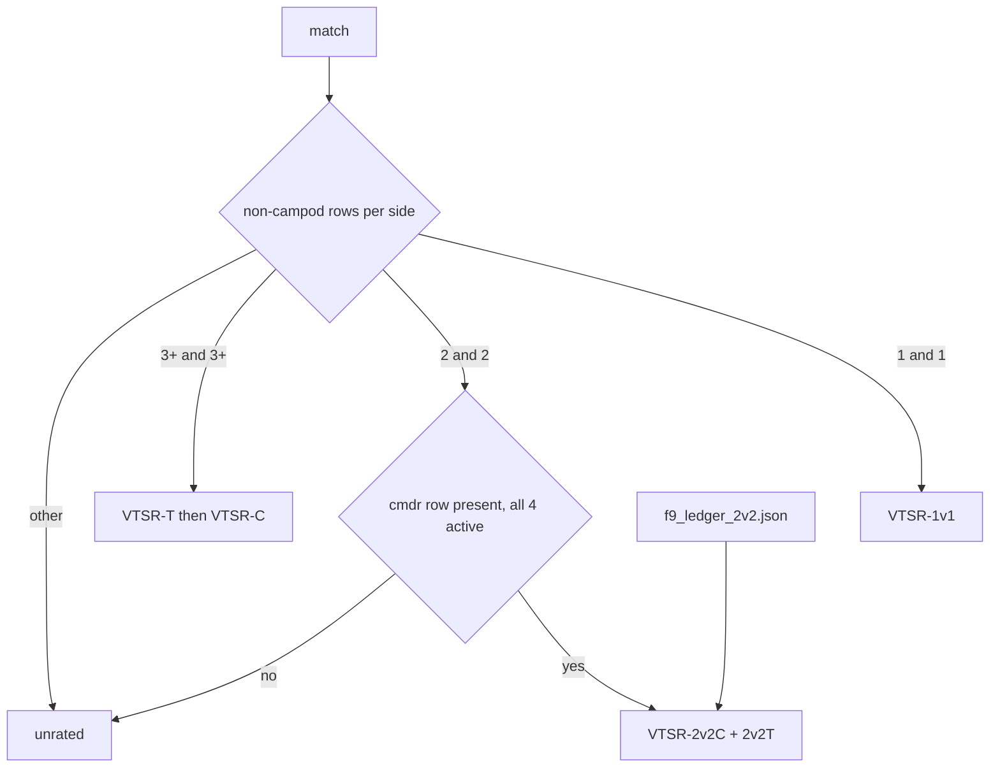

# VTSR-2v2 ladders (2v2C + 2v2T)

## What the research found

- **Recorded corpus:** 11 games have a 2v2 shape, and 9 of those have a decided outcome and last at least 240 s. One of the 9 (`2026-09-29T04-06-06`, thug Cyber low-activity with zero damage) was really a 2v1, which leaves **8 strict 2v2s**.
- **F9bomber's sheet:** 72 rostered 2v2 rows (2025-01 to 2026-09, 39 players) pass every importer gate except size. Today `THUGS_PER_SIDE = (2, 3, 4)` drops them (`scripts/import_f9_ledger.py` line 83).
- **Current ratings transfer poorly to 2v2.** On the 8 strict games, the thug VTSR-T gap picked 2 winners, the VTSR-C gap 5, and the sum of all four players' VTSR-T 5. 2v2 commanders fight heavily (VTrider dealt 210k as commander), so the 3+v3+ assumption that a commander's own combat does not count likely fails here.
- **Format lines are fuzzy today.** Four separate places define "format":
  - `elo.py` counts at least 6 non-campod players, with no per-side minimum.
  - `elo_1v1.py::one_v_one_players`.
  - `validate_elo.py` uses `FORMAT_SMALL_MAX_PER_SIDE = 2`.
  - `js/players-tab.js` uses `MIN_SIDE = 3` and a stricter activity count.

## Format lines (one shared definition)

New pure helper `scripts/match_format.py`:
- **Shape** is the number of non-campod leaderboard rows per side (slots 1-5 and 6-10). This is the same count the existing at-least-6 gate uses.
- **1v1:** 1 and 1. Unchanged; `one_v_one_players` keeps byte-identical output.
- **2v2:** 2 and 2, and each side's slot-1/slot-6 commander row must be one of the non-campod rows. It is **rated only when all 4 are active**: no row low-activity and no thug zero-damage. A 2v2-shaped game that fails this counts as `skipped_inactive_player`. Campod spectators are unlimited.
- **3+v3+ (team):** at least 3 per side (new) and at least 6 in total (existing).
- **Everything else** (2v1, 3v1, 3v2, 4v2, 1v0) is unrated by every ladder.

## Math (frozen in a new decision memo)

**VTSR-2v2C and VTSR-2v2T (win/loss) as one joint team walk:**
- Win chance: `E1 = 1/(1+10^(-((C1-C2) + λ(T1-T2))/400))`, with λ = 1.0. This is VTSR-C's formula, with T taken from the 2v2 win/loss thug ladder.
- Score: S is 1, 0, or 0.5 for a draw.
- Update: `ΔC = Kc(S-E)` and `ΔT = Kt(S-E)`. Each role uses one K per game (the mean of both players' 40-to-20-over-5-games schedules), so each role is zero-sum.
- Constants: anchor 1500, no floor. No seeding from the main ladders, so this ladder stays separate, like 1v1.
- Sources: recorded strict 2v2s with a determined outcome or a draw, plus F9 2v2 rows. Games run chronologically, with F9 rows after same-day recorded games (VTSR-C precedent), and overlapping recordings are deduplicated.

**VTSR-2v2T (performance)** is a thug-vs-thug duel on recorded games only:
- Score: `S_A = eA/(eA+eB)`, where `e = personal.enemy_dealt` (VTSR-T's own single axis).
- Expectation: `E_A = logistic((RA-RB)/400)`, with the same K and anchor so the two thug ladders are directly comparable.
- It needs no winner, so it also rates undetermined games. It skips void, cancelled, short games and the case where both thugs dealt 0.

**Display:**
- All three ratings show numbers, like VTSR-1v1, so they can be compared. This is a deliberate exception to the rule that VTSR-T is never shown as a number, because these are separate experimental 2v2 ladders. Flagged for your review.
- Provisional below 5 games. A ranked number requires at least 5 games and activity within 90 days.

Each recorded game also stores a commander's own-combat share, recorded but not scored, as study input.

## Main-ladder change (3 per side)

- `scripts/elo.py`: add `ELO_MIN_PER_SIDE = 3`, a new `exclusion_reason: "short_side"` checked after `low_player_count`, and a counter `matches_excluded_short_side`. VTSR-C inherits it through `elo_history`.
- Zero rated games move today. Verify that the `elo_history.json` hash is unchanged. No `ELO_SCHEMA_VERSION` bump (inert-change precedent), recorded in the memo.
- Add reason copy in `js/app.js` (~6768) and `js/match-elo.js` (~83).

## Pipeline and data

- **F9 import:** `scripts/import_f9_ledger.py` gets a 2v2 pass (1 thug per side, same gates and overlap pairing) that writes a **new** `data/external/f9_ledger_2v2.json`. `f9_ledger.json` and `f9_community.json` must stay byte-identical. Extend `data/external/f9_name_map.json` for any unmapped names.
- **New module:** `scripts/elo_2v2.py` (pure, no I/O, `ELO_2V2_SCHEMA_VERSION = 1`) outputs:
  - `data/processed/elo_2v2_current.json`, holding `ladders.{commander, thug_wl, thug_perf}.ratings[]` plus constants and skip counters.
  - `data/processed/elo_2v2_history.json`, holding `games[]` with source `recorded` or `f9`, the win chance, and per-role before/after/delta.
- **Wiring:** call it in `scripts/process_stats.py` after VTSR-1v1 (~11474) in its own soft-fail block, and add both files to the `load_cache_index()` skip set (~2577).

## Evidence: do the existing ratings transfer?

- **One-shot study:** standalone `scripts/study_2v2_transfer.py` writes `_validation/2v2_transfer.{md,json}`. Using pre-match snapshots on every strict 2v2 (recorded + F9), it scores:
  - the main VTSR-C gap;
  - VTSR-C's formula with the main VTSR-T thug gap, λ in {0, 0.5, 1, 1.5};
  - plus the commander's own VTSR-T;
  - the team sum of VTSR-T;
  - the 2v2 ladders' own chronological prediction;
  - rank agreement between the performance and win/loss thug ratings.

  All with Wilson confidence intervals.
- **Ongoing check:** a forensic §23 `metric_vtsr_2v2` in `scripts/validate_elo.py` replays accuracy and log-loss, split recorded vs F9, and checks replay integrity. `report.json` schema 12 to 13, additive. `validation_summary.json` gains optional `latest.vtsr_2v2_accuracy` / `_n` for the Tools footer.
- **Memo:** `critique/decisions/vtsr-2v2-ladders.md` holds the eligibility rules, the frozen math, and the comparison period. It pre-registers the pick-one rule for thug ratings: at 30 or more strict recorded 2v2s, compare out-of-sample log-loss of the joint model with each thug variant as T, plus split-half consistency; if neither wins, keep both.

## ELO page

- **`elo/index.html`:** a `nav-item dropdown` "2v2" pill after 1v1, with `dropdown-item` buttons (`data-bs-toggle="pill"`) for `#elo-tab-2v2c` (Commanders) and `#elo-tab-2v2t` (Thugs). The toggle label shows the active child. Popper uses a fixed strategy, because `.vt-tab-scroll-wrap` scrolls and would clip the menu.
- **Thugs pane:** a segmented `vt-econ-log-pills` control: Performance | Win/loss | Compare. Compare is one table with both ratings, both ranks, the rank difference, and games per variant. Commander game logs carry a recorded/F9 source chip and the F9bomber credit.
- **`js/elo.js`:**
  - `TAB_SLUGS` gains `2v2c`, `2v2t`, and alias `2v2` pointing to `2v2c`, plus `&view=perf|wl|compare`.
  - New `render2v2CommanderLadder` / `render2v2ThugLadder` reuse the 1v1 table, detail, sort and chip helpers (lines 1269-1519).
- **How tab:** a new `twoVTwoLaddersHtml()` in `js/vtsr-explainers.js`, plus a short "Which ladder rates my game?" box (1v1 / 2v2 / 3+v3+ / unrated, with spectator pods called out). This is the user-facing statement of the format lines.

## Tools Balonce 2v2 mode

- **`tools/index.html` card header:** a `Team | 2v2` pill group. In-memory state in `js/tools/team-balonce.js`; Reset all returns it to Team.
- **`js/tools/player-resolver.js`:** loads `elo_2v2_current.json` (404-safe) and attaches `vtsr2v2c`, `vtsr2v2tWl`, `vtsr2v2tPerf` plus games and provisional flags, and `get2v2Meta()` for the dials.
- **Win chance:** the same `VTBalonce.computeWinProb`, fed C from VTSR-2v2C and T from VTSR-2v2T win/loss. The meter itself does not change; only the copy does.
- **Suggest:** exactly 1 commander and 1 thug per side; if commanders are not set, try every commander pair. The empty-seat rule is off in this mode.
- **Guards:**
  - If more or fewer than 4 players are playing, the meter is replaced by a warning: "2v2 needs exactly 4 players; right-click spectators and choose Ignore this player."
  - Hidden lobby members (slot 255) are auto-ignored on entering 2v2 mode and can be restored.
  - In Team mode with exactly 4 playing, a hint chip suggests 2v2.
- **Footer:** shows the 2v2 accuracy when present, else "not validated yet, N rated 2v2s", and "Ratings as of" from `elo_2v2_current.computed_at`. The main-reason line drops the corpus-record tooltip.

## Player page and per-match Elo tab (mirror 1v1)

- `js/player.js`: a combined `#vt-player-2v2` block on the Commander tab next to the 1v1 block. It holds 2v2C plus both 2v2T ratings and self-hides when the player has no 2v2 games.
- `js/match-elo.js` + `index.html`: a `#section-match-elo-2v2` card on rated 2v2 matches showing the pre-match win chance and the commander and both thug deltas.

## Separation gate

`_investigation/check_2v2_separation.py` checks:
- VTSR-T, VTSR-C and 1v1 outputs are identical with the 2v2 module stubbed out.
- No forbidden consumer reads the 2v2 files or the 2v2 ledger: `elo.py`, `elo_commander.py`, `elo_1v1.py`, `js/all-matches-aggregator.js`, `js/players-tab.js`. Allowed readers: `js/elo.js`, `js/player.js`, `js/match-elo.js`, `js/balonce-meter.js`, `js/tools/*`.
- Every rated game is a strict 2v2.
- Each role is zero-sum per game, and rating chains are continuous.
- A replay agrees with the current file.
- F9 overlaps are deduplicated, and `f9_ledger.json` is byte-identical.

## Docs

- `DEVELOPER_GUIDE.md`: new §13.16.
- `docs/DATA_DICTIONARY.md`: new §19 (outputs + `f9_ledger_2v2.json`).
- `filter-contract.mdc`: reference rows for the 2v2 files (corpus-wide, picker-unaware), manifest/contribution `match_format` (picker-only, not a rating input), the picker Format facet, and the Outcome card's 2v2 branch (match-global).
- `project-overview.mdc`: ELO pills, Tools 2v2 mode, picker facets, Experimental-tab toggle removal, key file locations.

## Shared `match_format` field

- `scripts/match_format.py::classify_format(md)` returns which ladder considers the game: `"1v1"`, `"2v2"` (strict, all 4 active), `"team"` (3+v3+) or `"other"`. "Considers" is not the same as "rated": the outcome and duration gates still apply.
- `scripts/process_stats.py` stamps it as `match_format` on every manifest entry (next to `active_player_count`, ~11448) and every `_extract_contribution()` entry. Both are rebuilt every run from cached match data, so no `PIPELINE_VERSION` or `match.schema_version` bump is needed.
- Today's counts: 18 `1v1` (most are short or undecided), 10 `2v2` plus the inactive one in `other`, 271 `team`, and the rest `other`.

## Match-picker Format filter

- **UI:** a Format facet in `#match-picker-modal` (`index.html`) beside the player-count facet. Multi-select chips `1v1 · 2v2 · 3+v3+ · Other`, each with its match count; empty means Any.
- **State in `js/app.js`:**
  - `pickerState.formats` (array) in `DEFAULT_PICKER_STATE()`.
  - An optional key under `vt.picker.filters.v2`, with no storage-key bump (the `hasVod` precedent).
  - URL `?fmt=1v1,2v2` in both URL builders (~332 / ~417), read back next to `cnt` (~1516).
  - A filter test in the entry predicate next to `playerCounts` (~1215), the active-filter count (~1316), clear-all, the trigger subtitle and the All Matches banner copy.
- **Behaviour:** the All Matches aggregate re-scopes through the existing debounced `loadAllMatches()`, so the aggregator itself does not change. The filter only affects which matches are shown or aggregated; ratings stay corpus-wide.

## Outcome card on 2v2 matches (Balonce + Elo data)

- **Data:** `js/balonce-meter.js` gets `ensure2v2HistoryLoaded()`, shared with `js/match-elo.js` the same way `ensureCmdrHistoryLoaded()` is shared, so there is one fetch of `elo_2v2_history.json`.
- **When it applies:** `joinMatch()` (~532) bails out on `match_excluded` today. It gains a branch: when the match has a `games[]` row in the 2v2 history, it builds the read from that row instead of returning `{available: false}`.
- **What the card shows:**
  - The gauge and `Team N favored X%` headline from the stored pre-match win chance (joint 2v2 model), with the same band labels.
  - The same verdict chip rules (good game / Turn / Upset).
  - A main-reason line classifying the commander gap against λ times the thug win/loss gap, using the same 25 / 50 constants. There is no corpus-record tooltip, because there is no 2v2 record yet.
  - Roster chips: VTSR-2v2C on commanders, and both 2v2T numbers (performance and win/loss) on thugs.
  - The after-game section: commander 2v2C deltas, thug win/loss deltas, and the performance duel score S against E for the two thugs.
  - A small `2v2 ladder · experimental` chip and a link to `elo/?tab=2v2c`.
- **Not covered:**
  - Cancelled or undecided 2v2s have no win/loss row. An undecided game still has a performance row, so only the thug-performance part renders there.
  - No what-if for cancelled 2v2s (the 2v2 module emits no shadow block).
- **Contract:** match-global and always unfiltered, the same as today's card.
- **Gate:** the separation gate allows `js/balonce-meter.js` to read the 2v2 files. That is a deliberate difference from the 1v1 rule, recorded in the memo.

## Players tab aligned to the shared classifier

- **Change:** `js/players-tab.js` drops `MIN_SIDE` and `activeSideCounts()` (lines 15, 152) and reads `match.match_format === 'team'` from contributions for recorded games. The F9 ledger stays size-based (it is 3v3+ only).
- **Consequence:**
  - Once the main ladders require 3 per side, every rated recorded game is `team`, and the ledger is 3v3+. So the "Schedule format" toggle (`3+ a side` / `All rated`, `index.html` ~1563-1577) no longer changes anything, and it is retired along with `state.format` / `passesFormat()`.
  - Exactly 1 of 262 rated matches changes classification. It counted as small under the tab's stricter idle-row count and becomes `team`.
- **Unchanged:** the Players tab stays a forbidden consumer of the 2v2 files.

## Later (not in the todos)

- Refresh the stale small-format numbers in `elo/analysis` §10.
