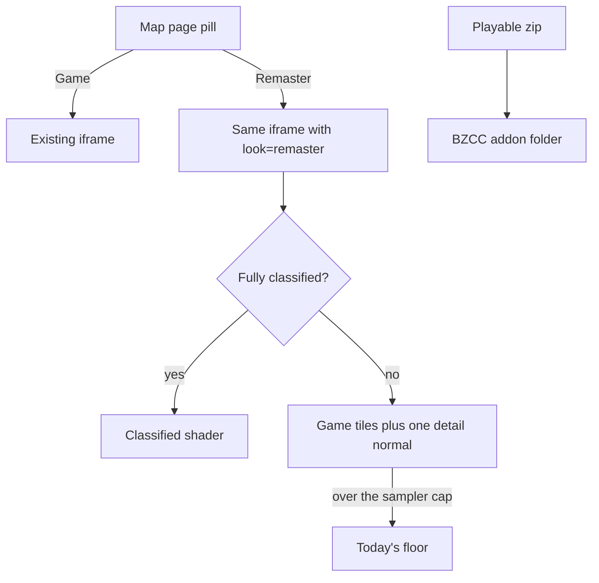

# Map remaster look

The proof is two extra 3D views, on the Remnant and Excavation map pages only (`/map/vsrremnant/` and `/map/stvsrexcav/`). The site’s map route is `/map/`, and those two pages already embed the viewer. The Explorer and the replay keep today’s look. Nothing is stored in `localStorage`, and Low / Medium / High do not grow a checkbox.

Oasis is out of this proof. It paints the same `dune1.tga`–`dune9.tga` as Remnant, so it gets no second pill and no second download. Vegan is four `mire` variants of one swamp. A later pill could name it. This proof does not.

The attached frame’s sky, haze, and contact shadows are already the engine atmosphere in [`_map-analysis/render/js/atmosphere.js`](_map-analysis/render/js/atmosphere.js) and [`_map-analysis/render/js/shadows.js`](_map-analysis/render/js/shadows.js). The dated part is the floor in [`_map-analysis/render/js/tile-floor.js`](_map-analysis/render/js/tile-floor.js): game diffuse tiles, a 32 m repeat, roughness fixed at 0.85, no normals. Scenery in [`_map-analysis/render/js/props.js`](_map-analysis/render/js/props.js) binds perf diffuse and emissive only. The remaster iframe is the one place those scenery maps gain normals and the game’s own spec-gloss. Replay hulls and the Explorer ship are out of this proof. Remnant keeps Remnant’s sky.

## Stock material slots

A mesh `.material` already names five files: `diffuse` (`_d`), `teamColor` (`_c`), `emissive` (`_e`), `normal` (`_n`), and `specular` (`_s`). The spec map is spec-gloss. RGB is the tint and alpha is the gloss. Highlight tightness is `specularPower`: 20 with specular `0` for matte ground and rock, 20 with specular `0.5` for a broad shine, 1024 with specular `0.5` for a tight metal glint. `convert_msh.py` already folds that power into `textures/specular_true/`.

The terrain shader does not sample a normal or a spec map. A tile is a diffuse, and an emissive (`_e`) is the only extra slot it has. Neither proof map has glowing ground, so the playable zip does not ship an `_e`. The in-game jump on a building is those five mesh slots. The page view is the only place the ground gets normals, hex tiling, and slope blending.

The remaster iframe binds `textures/specular_true/`, the alpha-gloss bake, not `textures/specular/`, the stylized luminance bake the models viewer uses by default. The DirectX normal flip stays `normalScale (1, -1)` because the corpus DDS is DirectX. Ground normals downloaded below are OpenGL (`NormalGL`) and are not flipped.



## What stays put

- The 8 m heightmesh. Remnant is 100 m of relief on a 1280 m sheet. Excavation is 100 m on 4 km. The repeating carpet is the problem, not the silhouette. No displacement, no 2 m rebuild.
- The splat. InfoMap chooses the layer, the three alpha maps blend it, the color map tints it at the existing `COLOR_TINT_STRENGTH` of 0.45. That tint is why Remnant stays Remnant and Excavation keeps its warm `230 230 190` ground. Do not retune 0.45.
- Sun direction, sun colour, ambient colour, cascade count, and PCF. No second directional light. No image-based lighting. The models viewer already lost that fight with the sun.
- The 16 local fog volumes. They stay decoded and undrawn.
- Top-down capture. `STATE.topdown` forces the engine floor, so `data/render/topdown/*.png` is not recaptured.
- Ratings, the pipeline, match JSON, and `PIPELINE_VERSION`. The packer is a standalone script. `process_stats.py` does not call it.
- The Explorer, the replay, and the quality presets. This proof does not read or write their settings.

## The materials

Four downloads, two arrays. Nine dune photos would fight the splat and look like a collage. Beach sets are out: Ground056, Ground060, and Ground061 are wet sand or sand with shells.

Each download is the ambientCG 1K-JPG zip. Keep Color, NormalGL, and Roughness. Drop displacement, ambient occlusion, and metalness. Sand and rock are dielectric. If a zip 404s, stop. Do not pick a neighbor.

- Fine sand is [Ground054](https://ambientcg.com/a/Ground054). Warm grey-brown, matte, about 3.5 m.
- Dune grain is [Ground037](https://ambientcg.com/a/Ground037). Tan, about 2.1 m. The wind ridge is not in the photo. The dune layer adds a 1.5 m sine to the normal along +X, a small amplitude, after the sampled normal.
- Sandstone is Ground054 again. Albedo times 0.82, roughness plus 0.08. No third sand file.
- Gravel, `mars7`, is [Gravel029](https://ambientcg.com/a/Gravel029). Pebbles, about 3 m.
- Rock, `mars5` and `mars1`, is [Rocks011](https://ambientcg.com/a/Rocks011). It is procedural and tiles. Rocks022 is a 50 cm photo and would repeat as a stamp at 32 m, so it loses.
- Pool rock is Rocks011 with `wet: 0.65`.

The water normal is generated in the packer, 512 px, two sine octaves. It is not a download.

Assignment of `dune1`–`dune9` is measured, not picked during the shader work. A one-shot read of the extracted tiles in `data/render/tiles/` prints mean luma and a Laplacian energy (high-frequency contrast). Sort by contrast:

- three lowest-contrast tiles → fine sand
- three highest-contrast tiles → rippled dune
- the three left → sandstone

A pair within 5% of each other stays in the lower bucket. The resulting stems, the measured numbers, and the ambientCG id go in `data/render/remaster/materials.json`. Excavation is fixed by the `.TRN` comments, not by the sort:

- `mars7` → gravel, normal strength 1.0
- `mars5` → rock, normal strength 1.15
- `mars1` → the rock albedo and the rock normal, `wet: 0.65`

`wet` multiplies roughness in the shader. It does not darken the albedo. The color map already tints the pool.

Pack with a new standalone [`scripts/build_remaster_arrays.py`](scripts/build_remaster_arrays.py). It writes four albedo PNGs and four normal PNGs (roughness in alpha) under `data/render/remaster/`, plus the generated 512 px water normal. The browser builds two `DataArrayTexture`s at load. A vertical atlas strip is the wrong pack: bilinear filtering bleeds between layers. Four times 1024 times two RGBA textures is about 32 MB, and it loads only when the look is on. 1024 is the ceiling. If a shot looks soft, raise the normal UV frequency before raising the resolution. Anisotropy is 8, the same cap props already use. Generate mipmaps.

`materials.json` shape:

```json
{
  "credits": [{ "name": "ambientCG", "url": "https://ambientcg.com", "license": "CC0" }],
  "materials": [
    { "id": "sand", "source": "Ground054", "albedo": "sand.png", "normal": "sand.png" },
    { "id": "dune", "source": "Ground037", "albedo": "dune.png", "normal": "dune.png", "rippleM": 1.5 },
    { "id": "sandstone", "source": "Ground054", "albedoScale": 0.82, "roughnessAdd": 0.08 },
    { "id": "gravel", "source": "Gravel029", "albedo": "gravel.png", "normal": "gravel.png", "normalScale": 1.0 },
    { "id": "rock", "source": "Rocks011", "albedo": "rock.png", "normal": "rock.png", "normalScale": 1.15 },
    { "id": "pool-rock", "source": "Rocks011", "wet": 0.65 }
  ],
  "tiles": { "dune1": "sand", "mars7": "gravel", "mars5": "rock", "mars1": "pool-rock" }
}
```

The dune keys are whatever the measurement writes. The array is four layers, in order: sand, dune, gravel, rock. Sandstone samples the sand layer and applies `albedoScale` and `roughnessAdd`. Pool rock samples the rock layer and applies `wet`. Neither gets its own image.

## The floor shader

New module [`_map-analysis/render/js/terrain-remaster.js`](_map-analysis/render/js/terrain-remaster.js). [`buildTileFloorMaterial`](_map-analysis/render/js/tile-floor.js) grows one argument, `look`. The engine path is the function as it stands today. Remaster is a different `onBeforeCompile` body and a different `customProgramCacheKey`. Terrain cuts and `shadows.js` `prepareMaterial` already wrap `onBeforeCompile`. The remaster code stays inside the assignment they wrap. It does not replace the wrapper.

Two variants. Pick per map, never both in one program.

**Classified.** Every tile slot this map actually uses is in `materials.json`. Remnant’s nine dunes and Excavation’s three mars tiles are this path. Empty Excavation slots 0, 1, and 5 are unused and do not count. The shader samples:

- the five splat atlases (`uColor`, `uAlpha1`, `uAlpha2`, `uAlpha3`, `uInfoMap`)
- `uAlbedo` and `uNormal` as `sampler2DArray`
- the four cascade maps, attached later by `shadows.js`

That is 11. The per-group DDS samplers are absent from this program. `customProgramCacheKey` returns `vt_tile_remaster`. If a proof map takes the other path, log one warning. Those two stems are the test that the table is complete.

**Fallback.** Any used slot is missing from the table. Keep today’s DDS groups. Add one `sampler2D` detail normal, the fine-sand normal. Roughness is `mix(0.95, 0.55, luma)`. The detail normal repeats every 4 m at strength 0.35, added to the vertex normal. Budget is 5 + groups + 1 + 4. The corpus tops out at 4 groups, which is 14. If `5 + groups + 1 + 4` exceeds `MAX_TEXTURE_IMAGE_UNITS`, do not build this variant. Stay on the engine material and warn once. The toggle still works on every other map, and a tight GPU degrades to today’s floor instead of a black one.

Sampling, in order, inside the classified `map_fragment` replacement:

1. The existing splat. Same UVs as today: `hmUv` from the local XZ frame, tile choice from the info nibbles, blend by alpha1 then alpha2 then alpha3. The blend weights are what select materials. They are not thrown away.
2. Albedo UV is `local.xz / 32`, the existing `TILE_METERS_PER_REPEAT`. Normal UV is `local.xz / 8`. The grain is four times finer than the colour blotch, so the sand reads as a surface instead of a stretched photo.
3. Hex tiling on both UVs, independently, so the grain does not lock to the colour. Use the three-tap method from Morten Mikkelsen’s practical hex tiling. Three fetches of the same array, barycentric blend. Heitz–Neyret needs a permutation texture, and that is a sampler this shader does not have.
4. Triplanar on slopes. `slope = 1 - abs(N.y)`. Below 0.45, top-down only. From 0.45 to 0.75, blend toward triplanar. At 0.75 and above, weights are `pow(abs(N), 4)` renormalized. Each plane runs the same hex function. This is the Excavation rock face and Remnant’s ridges.
5. Slope material. When `slope > 0.55` and the winning layer is a sand id (`sand`, `dune`, or `sandstone`), mix in up to 40% of `rock` by `(slope - 0.55) / 0.45`. Gravel and rock already are stone, so they gain nothing. Remnant ridges stop being rippled sand stood on end.
6. Tint. `albedo *= mix(vec3(1.0), colorMap, 0.45)`.
7. Macro. A world-space hash at about 80 m multiplies albedo by a value in 0.94–1.06. No texture. Hex tiling kills the 32 m grid and still leaves one dune everywhere. This is the second break, and it stays small.
8. Roughness comes from the normal array’s alpha, plus 0.08 on sandstone, times `wet` (0.65 on pool rock, 1 otherwise), times `mix(1.0, 0.85, macroDark)`. Metalness is the uniform 0. Write it by replacing `roughnessmap_fragment`, with `material.roughness = 1` so the map multiplies cleanly.
9. Normals replace `normal_fragment_maps`. Strength is the material’s `normalScale` (1.15 on rock, 1 elsewhere). The dune layer then adds a 1.5 m sine along +X at a small amplitude. Sandstone samples the sand layer and multiplies albedo by 0.82.

`mat.map` stays the color atlas only so the existing include still compiles, exactly as the engine shader does today. The replacement owns the colour. `mat.metalness` is 0.

## Scenery and replay hulls

When the iframe was opened with `?look=remaster`, [`props.js`](_map-analysis/render/js/props.js) `bindTextures` also binds:

- `data/models/textures/normal/<material>.png`, `NoColorSpace`, `normalScale.set(1, -1)`, only if that stem is in the model index `normalTextures` list
- `data/models/textures/specular_true/<material>.png` as `roughnessMap`, `roughness = 1`, previous roughness stashed on `userData.vtBaseRoughness`, only if the stem is in `specularTextures`

Props fetch `data/models/index.json` once and cache it on the module. A name that is absent from the list is skipped. A 404 does not fail the prop. Emissive and the cutout test stay as they are. Props do not grow team colour. They are not team-tinted today.

These materials are separate programs from the floor, so they do not spend the floor’s 16 units. Low-poly silos stay low-poly. They pick up panel grain and a roughness response. The Game pill loads the iframe without the query, so scenery stays on today’s diffuse.

## Air and water

The map iframe uses the engine sun. These terms run only in the remaster iframe.

**Fill.** Do not add a `HemisphereLight`. It would shade props on a different path from the floor and stack on top of the real ambient. A fragment term, remaster iframe only, on the floor and on props:

`indirectDiffuse += mix(fogColor, skyColor, N.y * 0.5 + 0.5) * 0.15`

`fogColor` and `skyColor` are the colours `resolveAtmosphere()` already resolved for this map. 0.15 is the cap. The sun remains the only directional light.

**Ground fog.** `atmosphere.groundFog` is already decoded: `start`, `end`, `density`, `min_dist`, `max_dist`, `enabled`. When `enabled` and `density > 0`, a fragment term:

- height = `saturate((end - worldY) / max(end - start, 1))`
- distance = the same linear ramp the engine uses, from `min_dist` to `max_dist`
- result = `max(existingFog, height * distance * saturate(density))`

It can only add fog. It cannot clear the engine fog. Null or disabled ground fog skips the term. Remnant and Excavation each use whatever their own `.SKY` stored.

**Water.** Both maps have a `.WAT`. In [`liquids.js`](_map-analysis/render/js/liquids.js), remaster water gets `data/render/remaster/water-normal.png` (512, the CC0 water normal from the same pack step). Two scrolls, world XZ / 16 m at 0.015 cycles per second and world XZ / 7 m at 0.007. Roughness 0.08. Metalness 0. The engine look keeps today’s 0.35 metalness and 0.2 roughness, which is why the current sheet reads as plastic. Colour, opacity, and alpha test stay. Lava is untouched. Neither proof map is a lava map.

## The two map-page views

[`js/maps.js`](js/maps.js) already mounts one iframe per map page from `renderExploreCard` / `mountMapExplore`. The source is `_map-analysis/render/index.html?map=<stem>&embed=1`. That card is the proof. It is not a new route, and it is not a site-wide look.

On `vsrremnant` and `stvsrexcav` only, the card header gains two pills, `Game` and `Remaster`. The card opens on `Game`, which is today’s iframe. `Remaster` swaps the iframe `src` to the same URL plus `&look=remaster`. One iframe, not two. Loading both at once would render the map twice.

[`viewer.js`](_map-analysis/render/js/viewer.js) reads `look=remaster` from the query and passes it into `buildTileFloorMaterial`, `buildPropsGroup`, and `buildLiquidMesh`. It does not write `localStorage`. `STATE.topdown` forces the flag off. The standalone viewer HUD does not grow a checkbox. Any other map page has no pills. Typing `look=remaster` onto some other map by hand still has to render: a fully listed map uses the classified shader, anything else uses the fallback, and a GPU that cannot hold the fallback stays on today’s floor.

Under the iframe, the Remaster pill shows one line and a download link: the in-game file is the ground photos only. Credit ambientCG in that line.

No `MAP_TEMPLATE_VERSION` bump. The card is drawn by `maps.js`, not baked into the pre-generated stub. A short note in [`_map-analysis/render/README.md`](_map-analysis/render/README.md) records the 11-sampler split and the rule that `look=remaster` is a map-page query, not a stored setting.

## Playable experiment

The game can load a copy of each map. It cannot load the remaster. A terrain tile is a diffuse. An emissive is the only extra slot, and these two maps do not use it. A normal or a spec map on the ground is ignored.

Battlezone’s terrain shader is the diffuse tile times the material times ambient plus sun. It has no normal map, no roughness, no hex tiling, no triplanar slopes, and no extra ground-fog term. Those stay in the iframe. What the game can show is a sharper albedo on the same 32 m repeat, with the map’s own color tint still applied on top. The zip therefore ships the albedo only, and the page says so.

The same packer writes two folders and two zips under `data/render/remaster/playable/`:

- `remnant-remaster.zip`
- `excavation-remaster.zip`

Each zip is a renamed copy of the vendored map. The stem changes so the originals are never overwritten:

- Remnant becomes `vsrremnant_rm.bzn`, `.trn`, `.ter`, `.sky`, `.wat`, `.inf`, `.des`
- Excavation becomes `stvsrexcav_rm` with the same set

`.ter`, `.sky`, `.wat`, and `.bzn` are byte copies. Both `.bzn` files already point at `strategy02.dll`, which ships with the game, so the zip does not include a DLL. The `.des` keeps the original author’s text and adds one line that the layout is theirs (Remnant by MalevolencE, Excavation by Mortarion) and the ground photos are the experiment.

The `.inf` changes one field: `missionName` becomes `VSR: Remnant Remaster` or `VSR: Excavation Remaster`. `mapTga` stays the stock thumbnail name so the lobby art still resolves.

The `.trn` changes only `TileTexture` lines, and the new names are unique so a loose file cannot replace stock `dune1.tga` for every map:

- Remnant’s nine dune slots point at `vt_sand.tga`, `vt_dune.tga`, or `vt_sandstone.tga`, following the measured split. Several slots may share one file.
- Excavation slot `mars7` points at `vt_gravel.tga`. Slots `mars5` and `mars1` both point at `vt_rock.tga`. The wet factor exists only in the shader, so the pool and the cliff share one photo in the game.

Each TGA is 1024, RGB, no alpha, written from the albedo PNG. It is not pre-tinted. The game still multiplies the color map and the `.trn` diffuse, and baking our 0.45 tint in as well would tint twice.

`playable/README.md` is the install note, and both map pages link it next to the zip:

1. Have Battlezone Combat Commander installed and the VSR mod selected. These maps use VSR units and `strategy02.dll`.
2. Quit the game. It reads the addon folder at launch.
3. Unzip into `%USERPROFILE%\Documents\My Games\Battlezone Combat Commander\addon\`. One folder per map is fine. The game searches that tree for missions.
4. Launch with VSR. In Instant Action or as host, the strategy list shows `VSR: Remnant Remaster` and `VSR: Excavation Remaster` beside the real maps.
5. The layout, spawns, pools, and sky are the originals. The ground photos are the experiment, still repeating every 32 m.
6. Delete those addon folders to remove them. Stock `dune1.tga` and the original map files were never replaced.

## Check

Browser, desktop, on `/map/vsrremnant/` and `/map/stvsrexcav/`.

- The card opens on Game and matches today’s floor, including roughness 0.85 and the plastic water.
- Remaster on Remnant: the 32 m grid is gone, the grain is finer than the colour, ridges pick up rock, and the dune hue is still the map’s.
- Remaster on Excavation: gravel, rock, and a pool. Pool rock is the same stone, duller in the specular. A cliff face is triplanar.
- A building in the remaster iframe shows a normal response. Game does not.
- Another map page has no pills. The Explorer and a replay of Remnant still show today’s ground.
- `?topdown=1` on Remnant ignores `look=remaster`.
- The README steps match the zip contents: renamed stem, unique TGA names, original `missionName` gone, DLL absent from the zip.
