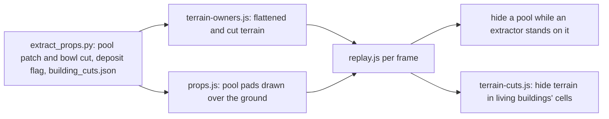

# Pool meshes, extractor swap, and engine terrain cuts

## What the research found

- **Every map with 3D data already has its pool meshes.** All 1,046 pools on the 152 maps with 3D data match a pool mesh row in `data/render/<stem>.props.json`. Only `vsr-training` and `vsrtransfer` lack 3D data, and their source folders are not on this machine. So "resolve missing pool models" comes down to keeping the yellow-marker fallback as a code path.
- **Why terrain shows through pools.** A pool ODF (`uepool01`, `miradorpool`, ...) declares a flat `terrain__h` patch over its 32 x 32 m footprint, plus one open cell (`tunnel01`, 16 x 16 m) over the bowl. The game flattens the ground to the pool's height and hides the terrain over the bowl. `scripts/extract_props.py` does this only for tunnel pieces (`OWNERSHIP_SCOPE = "tunnels"`). Pools therefore sit on the 8 m box-averaged ground, which pokes through the pad and covers the bowl.
- **Why sunken parts disappear.** Recyclers, factories, service bays, Kiln/Forge, the Dower and the bomber bay also declare open cells. The Matriarch (`fbrecy_vsr`) has 5, and they cover its lowered middle. The replay never cuts terrain under buildings it places during a match. It also seats every model by its lowest vertex (`cloneModelBody`, "hull bottom at local y = 0"), which is the ship rule. In the game, a building's base level (model-local y = 0, the level of its flat patch) sits on the ground. Extractors (Scion, ISDF, Hadean) have no cells of their own; their sunken parts sit inside the pool's bowl cut.

## 1. Sidecar data: [scripts/extract_props.py](scripts/extract_props.py)

- Admit deposit pieces (ODF `inheritanceChain` ends in `deposit`) into terrain ownership alongside tunnel pieces. Each pool then gets its flat `terrainPatch` and its bowl `tunnels` rect. `_hires_blocks` automatically adds the 2 m `.TER` blocks around pools, which gives crisp pad edges.
- Add `"deposit": true` to deposit pieces, so the JS identifies pool rows by ODF class instead of by name.
- Write `data/render/building_cuts.json`: for each building ODF with `tunnelCount > 0` and a model, `{stem, rects: [{x0, x1, z0, z1, y0, y1}]}` in engine-local metres. Reuse `_tunnel_rects` + `_glb_bounds`.
- `SCHEMA_VERSION` 3 → 4. Bump `?v=props3` → `props4` in [_map-analysis/render/js/loader.js](_map-analysis/render/js/loader.js), and the `props.js?v=` cache-busters in `replay.js`, `viewer.js` and [js/explorer/world.js](js/explorer/world.js).
- Rerun for all maps, then `python scripts/verify_terrain_scale.py`. The surface builder in [_map-analysis/render/js/terrain-owners.js](_map-analysis/render/js/terrain-owners.js) needs no change; watch its `ringConflicts` console stat.

## 2. Pools drawn over the ground: [_map-analysis/render/js/props.js](_map-analysis/render/js/props.js)

- Deposit pieces skip the `OWNER_DEPTH_OFFSET` (+1, terrain wins) rule. They get a negative `POOL_DEPTH_OFFSET`, so the pad always draws over the coplanar flattened ground.
- `buildPropsGroup` records `group.userData.pools = [{x, y, z, object}]` for deposit rows.
- Map page, replay and Explorer pick this up automatically. The Explorer scope stays pools only, per your answer.

## 3. Yellow markers only where no mesh exists

- Add a shared helper, `unmeshedPools(objects, props)`, to [_map-analysis/render/js/objects.js](_map-analysis/render/js/objects.js). It returns the `scrap_pool` objects with no deposit row within 2 m.
- `initObjects` in [_map-analysis/render/js/viewer.js](_map-analysis/render/js/viewer.js) and `initPools` in [_map-analysis/render/js/replay.js](_map-analysis/render/js/replay.js) pass only those to `buildObjectsGroup`. The `P` toggle keeps hiding the remaining fallback markers.

## 4. Extractor replaces the pool: [_map-analysis/render/js/replay-structures.js](_map-analysis/render/js/replay-structures.js)

- Replace `applyPoolUpgradeTint` with `applyPoolOccupancy(poolsGroup, propsPools, items)`, called from the same spot in `renderFrame`.
- A pool counts as occupied while a living extractor or upgrade is within `POOL_SNAP_M` (8 m). While occupied, its mesh is hidden, or its fallback marker instance is zero-scaled. Scrubbing back restores it.
- The upgrade swap already kills the base and spawns the upgrade on the same tick, so the pool stays hidden through it. A census or kill death shows the pool again.
- The pool is hidden only under a real catalog extractor. A box (models off) or a LEGO body sits on the visible pool instead, because those bodies do not fill the bowl.
- An extractor matched to a pool row takes that row's exact x, y, z.

## 5. Buildings seated by base level: [_map-analysis/render/js/replay-ship-models.js](_map-analysis/render/js/replay-ship-models.js)

- Add an option to `cloneModelBody`, used only for deployed buildings whose model declares a `terrainPatch`: it keeps model-local y = 0 on the ground. It undoes the template's lowest-point lift and skips the re-lift in `poseDeployed`.
- Ships, mobile recycler hulls and buildings without a patch keep the current rule. `STRUCTURE_GROUND_LIFT` (0.35 m) stays.

## 6. Building terrain cuts in the replay: new `_map-analysis/render/js/terrain-cuts.js`

- Load `building_cuts.json` (404-safe).
- `installTerrainCuts(material)` wraps `onBeforeCompile` and prefixes `customProgramCacheKey` the same way `shadows.js::prepareMaterial` chains. It adds a local-position varying and discards a fragment that falls inside an active rect and within that rect's vertical span.
- Apply it to the ramp, minimap and tile terrain materials before `prepareMaterial` runs. Also give the terrain mesh a `customDepthMaterial` with the same discard, so the cut ground does not shadow the pit.
- The rects are uniforms only (cap `MAX_CUT_RECTS` = 64), with no new sampler, so the floor's `5 + groups + 4 <= 16` budget is untouched.
- Each frame, refill the uniforms only when the set of living structures changes. Rects use the structure's placed x, y, z and the replay's `NOSE_YAW` wrapper rotation, so a cut always lines up with its mesh. A 90° turn keeps the rects axis-aligned.
- Cuts apply to every building whose game data declares cells (your "all" choice), and only when its body is a catalog model.
- Known limit: there is no runtime flattening for these buildings (the 2 m ground isn't shipped to the browser). On a sloped pad, the cut edge may not meet the floor exactly.

## 7. Docs

- [_map-analysis/render/README.md](_map-analysis/render/README.md): props schema 4, deposit ownership, `building_cuts.json`, dynamic cuts.
- `DEVELOPER_GUIDE.md` §12.2, plus a short line in the 3D Replay bullet of `.cursor/rules/project-overview.mdc`.
- No `PIPELINE_VERSION`, match schema or rating change: render sidecars are standalone.
- The committed top-down PNGs only change if they are regenerated.

## 8. Verification

- Map page 3D: Oasis, one `uepool01` map, one `miradorpool` map. Check clean pads, visible bowls, and no yellow markers.
- Replay `2026-10-27T04-00-33` (Oasis, v5 plant data): the extractor replaces the pool at the plant, the upgrade swap works, the pool comes back after a census death, and the Scion sunken ring is visible.
- A Matriarch match: the lowered middle is visible.
- Check shadows on and off, all three floor modes, and models off / LEGO.