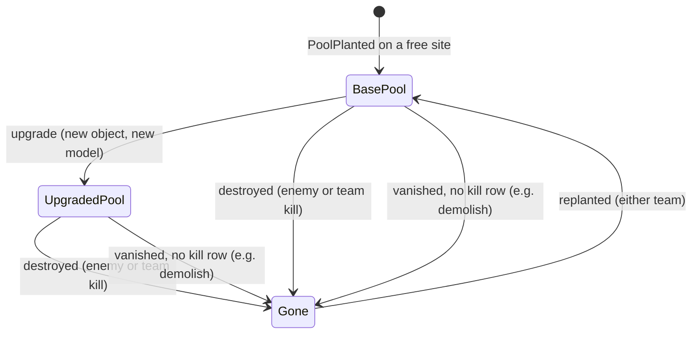
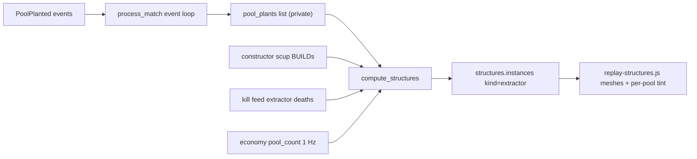

# PoolPlanted: extractors in the 3D replay

## What the new collector sends

From statsgate commit `69209d2`:

```protobuf
message PoolPlanted { uint32 tick = 1; uint32 teamnum = 2; Vec3 position = 3; }
// StatEvent oneof: pool_planted = 10, magnet_force = 11
```

- The event is written from the mission `AddObject` hook for any `CLASS_EXTRACTOR` (`record_pool_planted` in `statsgate/statsrecorder/stat_client.cpp`). It has **no ODF and no handle**. An upgrade replaces the extractor with a new object (confirmed by the user), so an upgrade also fires a plant at the same spot. The hook runs whether or not recording has started, so plants can arrive before the first tick.

### Pool lifecycle (user-confirmed)



- A plant always starts as the faction's base pool (Extractor / Harvester / etc.). A plant on a site already held by a living same-team pool is the upgrade replacing it, never a new pool.
- In the replay the base model must disappear and the upgrade model appear at the same pad on the same tick: one visual per pool site at any moment.
- A kill by the pool's own team (team kill, usually a mistake) is an ordinary destroy, the same as an enemy kill.
- A constructor demolish probably emits no event at all, so it falls into the "pool vanished with no kill row" path: the census rule retires it. The exact handling gets tuned once real data arrives.
- **Wire safety:** `MagnetForce` moved from field 10 to 11, but its recording code is commented out. `PlayerState.orientation`, `StatHeader.recorder_type` and `AIState` are declared but never set. No recorded file has field 10, so the proto can be mirrored verbatim without freezing a v4 copy.
- **Same commit:** `WantBotKillMessages()` is meant to fix missing `UnitDestroyed` events for AI units. Measured over 183 build-telemetry matches, four unit families almost never get a death row: gun towers (Gun Tower / Gun Spire / Spike / Defender, 3 of 436), constructors (0 of 839), service trucks (0 of 495) and barracks (0 of 21). Scavengers, tanks, extractors, factories and power plants do get deaths. `ignored_odfs` in the collector is never populated, so the gap is the callback, not a filter. This plan only measures the effect; it does not act on it.
- No session file has the event yet, so everything below gets checked with fixtures now and with the probe once real data lands.

## Data flow



## 1. Sync the proto and stamp v5

- Copy `statsgate/statsgate.proto` over [scripts/statsgate.proto](scripts/statsgate.proto) verbatim. Regenerate `scripts/statsgate_pb2.py` with grpc_tools, and `vendor/protobufjs/statsgate.proto.json` via `cmd /c npx -y -p protobufjs-cli pbjs -t json ...`.
- In [scripts/process_stats.py](scripts/process_stats.py) `load_session`: after the v4 marker is found, keep scanning for any `pool_planted` arm and return a new `PROTO_SCHEMA_V5 = "v5"` when one exists. A v5 file with no plants still reads as v4, which is harmless.
- In [js/raw-browser.js](js/raw-browser.js): add the v5 presence check; add `poolPlanted` (and a `magnetForce` label, so a future event never renders blank) to `EVENT_ARMS_ALL`, `EVENT_ARMS_BY_SCHEMA.v5`, `EVENT_ARM_LABELS` and `PROTO_TYPE_MAP`; add a reconcile row comparing the poolPlanted count to the extractor instances.
- Run `scripts/verify_proto_decode.mjs` on one file per schema era.

## 2. Pipeline: extractor instances on `structures`

- Event loop: a new `elif event_type == "pool_planted"` branch collects `{tick, teamnum, x, y, z}`. Team 0 is skipped. Ticks before `tick_range[0]` are clamped to the start tick. It sets `match_has_pool_plant_data`. The list goes to `compute_structures` as a parameter, never into the JSON.
- `compute_structures` (around line 5508) gains a pool pass, used only when plants exist:
  - **Sites:** group plant positions within `POOL_SITE_M` (8 m, tunable) into per-match `site` ids, so a pool replanted after a death keeps its site.
  - **Base extractor:** a plant on a site with no living same-team instance makes a new instance `{id: "pool-<side>-<n>", kind: "extractor", odf: faction base stem, site, spawn_tick, ...}`. The base stem comes from a new `_FACTION_EXTRACTOR_STEM` = `ibscav_vsr` / `ebscav_vsr` / `fbscav_vsr` (all confirmed in `odf.min.json`), or null when the faction is unknown.
  - **Upgrade:** a plant on a site that already has a living same-team extractor means an upgrade. The base instance retires with `death_reason: "upgraded"`. If a constructor `*bscup` BUILD instance lands within `UPGRADE_JOIN_SEC` on that site, it gets the site and no duplicate is made. Otherwise a new upgrade instance uses the faction `*bscup_vsr` stem.
  - **Deaths:** extractor-class kill-feed rows (`build_extractor_odfs`) go through the existing nearest-to-killer rule, now covering pool instances; the row's ODF decides base vs upgrade. Killer team does not matter (a team kill is `destroyed` too). After any death the site is free for either team to replant.
  - **Census deaths** (your choice; also covers constructor demolishes): for each team, compare living pool instances with `economy.teams[n].pool_count`. If the census stays below the living count for `CENSUS_GRACE_SEC` and no kill matched, retire one instance with `death_reason: "census"`. It picks the one nearest an enemy player's trail at that second, else the oldest.
  - **QA:** `structures.pool_census = {checked_sec, agree_share, retired_by_census, surplus_sec}`. `surplus_sec` counts time when the census shows more pools than were seen being planted.
- Constructor upgrade instances on pre-v5 matches also get a `site` and `kind: "extractor_upgrade"`, so the per-pool tint works on the old corpus.
- Versions: `structures.schema_version` 1 to 2, `match.schema_version` 33 to 34, `PIPELINE_VERSION` 57 to 58, plus `match.has_pool_plant_data` (absent means false). No ELO bump.

## 3. Replay renderer

In [_map-analysis/render/js/replay-structures.js](_map-analysis/render/js/replay-structures.js):

- Extractor instances use the existing `makeStructureVisual` path: the catalog model when one is loaded (`ibscav01`, `ebscav00`, the `*bscup` meshes), else a new `POOL_SIZE` box. Lifetimes work through `updateStructuresLayer`.
- Upgrade swap: the base instance's death tick (`upgraded`) equals the upgrade instance's spawn tick, using the same 0.05 s lead `replacedSec` uses, so the base model drops and the upgrade model appears in the same frame. Scrubbing backwards restores the base.
- Replace the whole-mesh pulse in `applyPoolUpgradeTint` with a per-pool tint. Snap each instance to the nearest map `scrap_pool` within `POOL_SNAP_M` (already declared, not used yet). Each frame, color that pool's instance by owner team (`setColorAt`), and keep the pulse only for upgraded pools.
- Two things need no new code: `structureFor` (attack lines) and `findStructureDeaths` (death flashes) already walk `structures.instances`, so extractor hits and deaths will land on the right pool.
- Bump the `?v=` cache key on the import in [_map-analysis/render/js/replay.js](_map-analysis/render/js/replay.js).

## 4. Gates and probe

- New `_investigation/check_pool_structures.py`, a fixture gate on synthetic `match_data` with these cases: plant then kill; plant then upgrade, with and without a BUILD (one visual per site at every tick); upgraded pool killed; team kill (treated as destroyed); replant on the same site by the other team; a pool that vanishes with no kill row (census death, the demolish case); a plant before recording started; team 0. It also checks that `pool_census` agrees on a clean fixture.
- Confirm that `_investigation/golden_replay_v26_inert.py` strips and perturbs the whole `structures` block, extending it if needed. VTSR-T and VTSR-C must come out byte-identical.
- Reprocess the corpus. Existing matches should differ only in versions, `site` / `kind` on upgrade rows and `pool_census` being absent.
- New `_investigation/probe_pool_planted.py`, to run on the first real batch. It reports:
  - team and tick distribution, including plants before recording started;
  - distance to the nearest map pool, to tune `POOL_SNAP_M`;
  - the tick gap between an upgrade plant and its `*bscup` BUILD (does it fire when construction starts or ends?);
  - census agreement and the number of census deaths;
  - built-vs-died counts for gun towers, constructors, service trucks and barracks, compared with the old-era baseline (3/436, 0/839, 0/495, 0/21). This is the evidence for a later decision on `TURRET_DEATHS_RELIABLE` and flags jumps in `pve_kills` / `kills.by_vehicle`.

## 5. Docs

`.cursor/rules/data-schema.mdc` (v5 section, event-table row 10, structures v2), `.cursor/rules/project-overview.mdc` (proto line), `.cursor/rules/filter-contract.mdc` (structures row: still always full-match), `DEVELOPER_GUIDE.md` sections 2, 3 and 5, and `docs/DATA_DICTIONARY.md` (structures and `has_pool_plant_data`).

## Deferred until the probe has run

Economy-tab pool ownership timeline, Storyline pool beats, a per-match turret-death reliability flag, and corpus-wide pool-site stats on map pages.