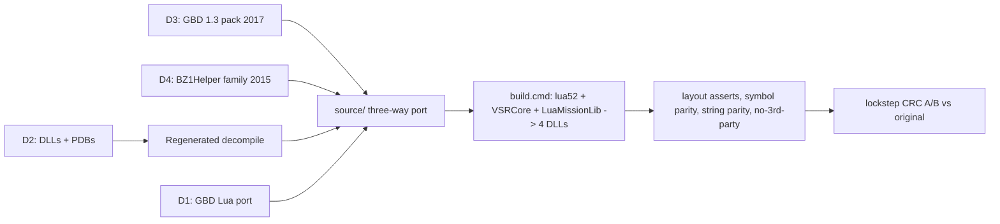

# VSR DLL Preservation + `.v` Archive Analysis

## Summary (read this first)

**What this is.** Battlezone: Combat Commander's most-played competitive mod, VSR (Vet Strat Recycler Variant), runs on four closed-source "mission DLLs" written by its lead developer, General BlackDragon (GBD). The game cannot play VSR without them, and no one can fix or extend them without their source. This project preserves everything available and rebuilds that source so the community can keep VSR alive, and documents what the recovered archive teaches VT Stats about the game.

**Why it is possible.** VSR's public Workshop repository (cloned in `.v/VSR_Workshop`) shipped the four DLLs **together with their PDB debug files** — not source, but the blueprint: every class, field, function, signature and source-line range. Decompiled with the PDB, `Strategy02.dll` already reads as fully named pseudo-code (regenerated by us before use). Better still, the code's public ancestors exist in the original authors' own repositories: GBD's GitHub holds the complete BZ2 1.3.7.2 mission source pack (stock `Strategy02`, `DllBase`, `LuaMission`, …), and Nielk1's repo holds the 2015 `BZ1Helper` family (`BZ1Helper`, `BZCScriptUtils`, `DispatchHelper`, `PortalHelper`, …) that VSR's `vsrcore/` grew from. GBD also wrote his own Lua rewrite of the three mission files, on an unmerged branch. So the job is a **three-way port** — ancestor source, brought up to VSR with the decompile as the diff oracle and the Lua port as cross-check — not transcription from pseudo-code. Only five small helpers (`gravity`, `objecthelper`, `vehiclehelper`, `ambientsound`, and `utilityship`, whose 2015 ancestor is too thin to use) are written from the decompile alone.

**What "rebuild" means.** Not GBD's exact text (treated as permanently unavailable) and not a byte-identical binary (unneeded; the game loads any DLL exporting `GetMisnAPI` with the right version magic). The target is **behavioural parity**, provable: BZCC is lockstep with per-turn CRC checks, so GBD's DLL on one machine and ours on another exposes any difference within seconds — backed by mechanical checks (struct layouts, symbol roster, string table) that catch divergence before a game is launched.

**Trust model.** Tier A: GBD's own artifacts and repos (DLLs, PDBs, Lua port, documents, Workshop content, his `LuaMission` repo). Tier A′: public primary source by the original authors at a different version (Nielk1/GBD 2015 helpers; Rebellion's installed SDK) — authoritative for what it is, every function still diffed against the decompile. Tier B: machine-derived from Tier A, trusted after we regenerate and diff (decompile, PDB manifests). Tier C: third-party work (VRV, `BZ_REA` engine docs) — hints and checklists only; no code copied; facts verified or labelled unverified.

**State at planning time.** Archive DLLs hashed byte-identical to the live Steam Workshop install (GBD's latest release build, linked 2026-02-20). Installed game is **2.0.185** (Steam build 3807009), exe and SDK header hashes matching the engine docs' measured target and VSR's `m_GameVersion = 20185`. Toolchain: VS 2022 MSVC 14.44 x86, BZCC SDK on disk, Python 3.13, git. All nine Workshop items (VSR + 8 asset packs) installed for parity-test maps. Every remote dependency verified reachable (see Dependencies). Missing: Ghidra + JDK (portable zips inside the repo, gitignored). Nothing has been written yet.

**Where things go.** Full-history mirrors → `.v/preservation/`. Analysis for VT Stats → `.v/analysis/`. Preservation + reconstruction → new sibling repo `c:\Users\dhira\Documents\Github\VSR_DLL_Source`, lean and self-contained (never references `.v/` or vt-stats), private until the VSR community settles a license. Nothing else on disk is written; the BZCC install is only read.

## Dependencies — exact sources (all verified 2026-10-28)

- **D1 VSR Workshop repo** (Tier A). Local clone `.v/VSR_Workshop`. Remote `https://github.com/BlackDragonN001/VSR_Workshop.git`: `master` @ `58a5f56` (local is 2 behind at `43cb157`), `Lua-Stock-Missions` @ `ea4173f`, `Test_Variant` @ `644e79f`. Fetch: `git -C .v/VSR_Workshop fetch --all --prune --tags`. Mirror: `git clone --mirror .v/VSR_Workshop .v/preservation/VSR_Workshop.git`.
- **D2 VSR DLLs + PDBs** (Tier A). `.v/VSR_Workshop/Upload/VSR/Missions/{Strategy02,LuaMission,Instant,deathmatch01}.{dll,pdb}`; identical SHA-256 to `C:\Program Files (x86)\Steam\steamapps\workshop\content\624970\1325933293\VSR\Missions\`. Linked 2026-02-20; `Strategy02.dll` SHA-256 `A4B3CE223FC3…`.
- **D3 BZ2 1.3.7.2-b132L DLL source pack** (Tier A — GBD's own public repo). `https://github.com/BlackDragonN001/LuaMission.git` @ `353698f578e00ea5f9806fea701b5bd7c69d94ce` (2017-10-19), folder `BZ2 1.3.7.2-b132L Dll Source Code/`: `Missions/{Shared,Strategy02,Deathmatch01,Instant,MPInstant,StratCTF,LuaMission,lua_5_1_5}`, `Missions.sln` + `.vcxproj`, `Source/fun3d/{AiCmds.h,ScriptUtils.h}` (1.3-era), `Source/network/vars.txt`, `Readme_Source.txt`, `Debug/lua51_lib.lib`. Fetch: `git clone --mirror … .v/preservation/BlackDragonN001-LuaMission.git`, then `git archive 353698f "BZ2 1.3.7.2-b132L Dll Source Code"` → `reference/ancestor-1.3/`. Seeds: `shared/{dllbase,dllutils,startingvehicles,taunts,trnallies,pupmgr,trace}`, `strategy02`, `deathmatch01`, `instantmission`, `luamission/{luamission,luabindings}`.
- **D4 BZ1Helper family** (Tier A′ — public primary source by the original authors, 2015 BZ2-era). "BZ1Helper" is the name of GBD's mission-DLL helper framework from his Battlezone Classic ("BZC") mod on BZ2 — not Battlezone 1 content; VSR's DLL is built on the same class (`Strategy02 : LuaMission : BZ1Helper : DLLBase`, `vsrcore/bz1helper.cpp`). `https://github.com/Nielk1/BZ2-LuaMission.git` branch `BZC-LuaMission-Integration` @ `6fda4f5ab3c2f2aae882ebe22b9ef6180e42f744` (2015-11-28), folder `BZ2 LUA Dll Source Code/Missions/Shared/`: `BZ1Helper`, `BZCScriptUtils`, `AIWeaponHelper`, `AttacherHelper`, `BuildingHelper`, `CarrierHelper`, `DispatchHelper`, `MorphObjectHelper`, `PortalHelper`, `PowerHelper`, `ProductionClassHelper`, `ScrapHelper`, `UndeployHelper`, `UtilityShipHelper`, `MathUtils` (+ helpers VSR does not use). Verified against the VSR decompile: same `MapInfo`/`TeamInfo`/`m_ScrapMultiplier`/`m_DamageMultiplier` declarations; identifier overlap `AttacherHelper` 6/6, `BZCScriptUtils` 8/9, `DispatchHelper` 6/9, `BZ1Helper` 5/9, `PortalHelper` 5/9 (misses = GBD's 2016–2026 VSR additions, supplied by the decompile); `UtilityShipHelper` 1/6 and a third of VSR's size → treated as decompile-first. Fetch: mirror to `.v/preservation/Nielk1-BZ2-LuaMission.git`, `git archive 6fda4f5 …/Shared` → `reference/ancestor-bz1helper-2015/`. Seeds 13 of the 18 `vsrcore/` files; `utilityshiphelper`, `ambientsoundhelper`, `gravityhelper`, `objecthelper`, `vehiclehelper` are written from the decompile.
- **D5 BZCC SDK** (Tier A′ — Rebellion, shipped with the game). `%BZCC_DIR%` = `C:\Program Files (x86)\Steam\steamapps\common\BZ2R`: `ScriptUtils.h` (SHA-256 `C60CB3BD…`), `AiCmds.h`, `battlezone2.lib`; game 2.0.185 / build 3807009. Read at build time, never committed. Do **not** use the EXU2 variant vendored in vt-stats' `statsgate/include/`.
- **D6 Lua 5.2.4** (MIT). `https://www.lua.org/ftp/lua-5.2.4.tar.gz` (252,651 bytes; SHA-256 recorded on download) → `third_party/lua-5.2.4/`. Rationale: the DLL embeds `"Lua 5.2"` and its 92 exported Lua symbols (`lua_pushunsigned`, `luaL_checkunsigned`, …) are the 5.2 API; GBD built from the private BZCC engine tree's Lua, so 5.2.4 (final 5.2) is the closest public release. Verified against `lua_api_Strategy02.tsv` at build.
- **D7 Ghidra + JDK** (tools, gitignored). Ghidra latest 11.x from `https://api.github.com/repos/NationalSecurityAgency/ghidra/releases/latest` → `tools/_local/ghidra/`; Temurin JDK 21 from `https://api.adoptium.net/v3/binary/latest/21/ga/windows/x64/jdk/hotspot/normal/eclipse` → `tools/_local/jdk21/`. Exact versions + hashes recorded in `tools/ghidra/VERSIONS.txt`.
- **D8 Existing decompile** (Tier B pending regeneration). `.v/VSR_dll_RE_attempt2/decompiled/` + `.v/lua_api_{LuaMission,Strategy02}.tsv`.
- **D9 Parity-test content.** Workshop items installed under `C:\Program Files (x86)\Steam\steamapps\workshop\content\624970\`: `1325933293` (VSR) + `3532748119`, `1329659846`, `2785557433`, `2785542655`, `2814914461`, `2049956570`, `3493379153`, `2467249743`.
- **D10 Third-party reference** (Tier C, no code). `.v/BZ_REA_documentation/` (engine internals for 2.0.185 — same exe hash as installed); `.v/vrv/vrv-main/` (its `src/` copies are superseded by D3 and are not used).
- **Dead ends recorded:** Rebellion "source announcement" (`battlezonecombatcommander.com/en/news/715`) redirects to a generic product page; `matesfamily.org/bz2/` is an index only — the pack itself is D3.

## Fixed decisions

- Repo: `c:\Users\dhira\Documents\Github\VSR_DLL_Source`, own git repo; tree mirrors GBD's as recorded in the PDBs (`E:\Github\VSR_DLL_Source\missions\{shared,strategy02,instant,deathmatch01,luamission,vsrcore}`), file for file.
- Build: `build/build.cmd` only, mirroring GBD's link structure from the PDBs — `lua52.lib` (D6), `VSRCore.lib` (`missions/vsrcore/*`), `LuaMissionLib.lib` (`missions/luamission/*`), then four DLLs each = own files + `missions/shared/*` + libs + `%BZCC_DIR%\battlezone2.lib`. MSVC x86 via `vswhere` → `vcvars32`; `/MT /O2 /Oy- /std:c++17 /W4 /Zi`; zero new warnings in our code; output `Build/Win32/Release/bin/missions/*.dll` (gitignored). The 1.3 pack's `.vcxproj` files are kept in `reference/` as the structural model.
- Method: **three-way port.** For each file: start from its ancestor (D3/D4), apply PDB-true declarations (names, signatures, struct layouts), then bring the body to VSR using the regenerated decompile as the diff oracle and GBD's Lua port as cross-check. Functions with no ancestor are written from the decompile.
- Style: **faithful first, pretty later.** Keep GBD's function boundaries and sizes (known from the PDB); no refactoring, no clever aggregate tables until parity is proven; later refactors on a separate branch under the parity harness.
- Stub policy: the tree compiles and links all four targets from day one; a function not yet ported keeps the PDB signature, a `// DECOMPILE: <file>:<line>` pointer and a safe default; `STATUS.md` tracks `stub → ported → reviewed → compiles → parity` per file.
- Port order (dependency-driven): tier 1 `mathutils`, `bzcscriptutils`, `shared/*` → tier 2 small helpers → tier 3 `bz1helper` + large helpers (`dispatchhelper` last) → tier 4 `luamission`/`luabindings`, `strategy02`, `instantmission`, `deathmatch01`.
- Parity harness: two BZCC installs on a LAN (original DLLs vs ours) on VSR maps from D9; `CRC Mismatch`/resync = failure. Pre-game mechanical checks: layout asserts, symbol parity, string parity, export table, save-record sizes, `VSR_<timestamp>.log` strings. **Prerequisite supplied by the operator:** a second machine with BZCC + the nine Workshop items (needed only for task 16).
- **Test footprint exception (the only write outside `.v/` and the repo):** to make the game load a DLL under test (tasks 4 and 16), the DLL is copied temporarily into the engine's user addon override folder `%USERPROFILE%\Documents\My Games\Battlezone Combat Commander\addon\missions\` and removed when the test ends; loading is confirmed via the process's loaded-module path. The Steam install is never modified.
- **Operating assumption at session start:** BZCC is running, launched from Steam, with VSR selected as the active mod. Tasks 1–3 and 5–10 are unaffected (they only read the install and the archive; copying the open Workshop DLLs/PDBs is fine). The game reads its file system once at launch, so for the task 4 load test the agent asks the operator to exit the game, places the DLL under test in the addon override folder, relaunches via `steam.exe -applaunch 624970`, starts a VSR strategy map, confirms the loaded-module path, then removes the DLL. Windowed/borderless video mode is preferred for that test; the agent never force-kills the game process.
- Tooling policy: Python scripts are stdlib-only; every binary tool (Ghidra, JDK) lives under `tools/_local/` (gitignored); PDB symbol extraction for the parity gate runs through that same Ghidra install; no system-wide installs, no `pip` into site-packages.
- Preservation scope: everything in GBD's repos and files kept as found. Full-history mirrors of D1, D3, D4 in `.v/preservation/`; the reconstruction repo stays lean and cites commits.
- License posture (`LICENSE-NOTES.md`, facts only): Workshop repo has no LICENSE; VSR documents ask permission for converted content; the 1.3 pack's `Readme_Source.txt` releases it as an unsupported template for DLL authors; Nielk1's repo license as published; SDK is Rebellion's and never redistributed; GBD's DLLs are public on Workshop and archived unmodified. Private until licensed; attribution layered later.
- The only content rule: **no outreach, estate or next-of-kin language or instructions anywhere.** Credits as the VSR documents and public repos print them (General BlackDragon, Feared_1, Zero Angel, Vearie, AI_Unit; Nielk1, Ken Miller, Nathan Mates and the 1.3 team for the ancestors; vacuum34, VTrider for referenced public work).

## QA gates (apply to every port task)

1. **Per-function checklist**: signature identical to the PDB; control flow and constants match the regenerated decompile; every string literal present in `globals.tsv`; ODF section/key names match; `Save`/`Load` write order and widths match; GBD's Lua port agrees where it covers the function; ancestor diff reviewed line by line (no ancestor-era behaviour left in that VSR removed).
2. **Layout asserts**: `tools/layout_asserts.py` emits `static_assert(sizeof(T) == N)` and `offsetof` checks for every PDB-recovered struct (`Strategy02` = `0xECA4`, `TeamInfo` = `0xA14`, …); build fails on mismatch.
3. **Symbol parity**: `tools/check_symbol_parity.py` diffs our build's PDB function roster (names, signatures, file membership) against GBD's PDB; differences explained in `STATUS.md`.
4. **String parity**: `tools/check_strings.py` requires every literal in the original DLL's string table to appear in ours; flags extras.
5. **No third-party code**: `tools/check_no_thirdparty.py` fails the build on any identifier/header from VRV or `BZ_REA` tooling in `source/`.
6. **Independent review**: each tier gets a second review pass by a reviewer shown only Tier A/A′/B evidence and the port — never Tier C — before `STATUS` flips to `reviewed`.
7. **Facts in documents**: Tier C claims labelled `[third-party, unverified]` unless reproduced (in-game test, SDK header, binary inspection); Tier A/A′/B claims cite `file:line` or commit.



## Repo layout

```
VSR_DLL_Source/
  README.md  PROVENANCE.md (tiers)  QA.md  DEPENDENCIES.md (pinned)  LICENSE-NOTES.md  CREDITS.md  STATUS.md  .gitignore
  original/            append-only, byte-exact (Tier A): missions/  lua/ (+ COMMITS.txt)  docs/
  reference/           read-only inputs, each marked with tier
    ancestor-1.3/ (D3)  ancestor-bz1helper-2015/ (D4)  decompiled/ (regenerated)  manifest/ (file list, line counts, BUILD_ENVIRONMENT.md, REPO_REFS.txt, FILE_MAP.md)  engine/ (Tier C, + SOURCES.md)
  source/              missions/{shared,strategy02,instant,deathmatch01,luamission,vsrcore}
  third_party/lua-5.2.4/
  build/build.cmd      -> Build/Win32/Release/bin/missions/*.dll (gitignored)
  tools/               scaffold_from_manifest.py, layout_asserts.py, check_symbol_parity.py, check_strings.py, check_no_thirdparty.py, check_status.py, ghidra/, parity/, _local/ (gitignored)
  docs/                BACKGROUND.md  RECOVERY.md  NETVARS.md
```

Every `source/` file carries `// PROVENANCE: ancestor <D3|D4 path @commit> + decompile <file:line> | gbd-lua-port | decompile-only | new`.

## Tasks (in execution order)

1. **Repo skeleton** — init git, tree above, `.gitignore`, `README`, `PROVENANCE`, `QA.md`, `DEPENDENCIES.md` (D1–D10 with fetch commands and pins), `LICENSE-NOTES`, `CREDITS`, empty `STATUS`.
2. **Preserve originals** — D2 + `SHA256SUMS.txt`; Lua port and Test_Variant verbatim with `COMMITS.txt` (`git log --format=fuller`); `VSR Documents/`, Workshop `.ini/.cfg/.des`, the two `lua_api_*.tsv`.
   2b. **Preservation mirrors** — fetch D1, then `git clone --mirror` D1, D3, D4 into `.v/preservation/`; all refs + hashes → `reference/manifest/REPO_REFS.txt`.
3. **Fetch pinned dependencies** — D3 folder → `reference/ancestor-1.3/`, D4 `Shared/` → `reference/ancestor-bz1helper-2015/` (via `git archive` at the pinned commits; verify `git rev-parse`), D6 tarball → `third_party/lua-5.2.4/` (SHA-256 recorded); write `DEPENDENCIES.md`.
4. **Prove the toolchain** — `build.cmd` with the lib structure; minimal `Strategy02.dll` whose `GetMisnAPI` fills `MisnExport` (version magic, no-op callbacks); export-table check; start a VSR map with it in place without crash.
5. **Reference inputs** — D8 copied (Tier B pending); `reference/manifest/` (verbatim PDB paths, per-file line counts, function + global tables, `BUILD_ENVIRONMENT.md`, `FILE_MAP.md` = which ancestor file seeds which VSR file, with size deltas); six engine docs → `reference/engine/` with `SOURCES.md` (Tier C).
6. **Scaffold** — `scaffold_from_manifest.py` seeds `source/` from the ancestors per `FILE_MAP.md`, overlays PDB-true declarations from `user_functions.tsv` + `vsr_types.h`, stubs only ancestor-less functions; `layout_asserts.py` emits the static asserts; all four targets compile, link, asserts pass.
7. **Runbooks + gate scripts** — `tools/ghidra/` (pinned portable install, headless script exporting decompile + TSVs in the archive's shape); `tools/parity/RUNBOOK.md`; `check_symbol_parity.py`, `check_strings.py`, `check_no_thirdparty.py`, `check_status.py`; `build.cmd check` runs them all.
8. **Regenerate the Strategy02 decompile** — Ghidra+PDB; diff against D8; record differences; promote to Tier B-verified.
9. **`.v/analysis/` documents** — `SUMMARY.md`; `ANALYSIS.md` (verdict; pipeline confirmations with our code locations → Tier A/B evidence; corrections/hypotheses to verify on the wire — DLL-side scavenger deposit credit, `ivar117`, `ivar26`, `ivar25`, `ivar81` collision; Tier C claims labelled — 15-char ODF truncation, `GameObjectClass` defaults, fog mode enum; vt-stats backlog; preservation checklist with hashes); `ANALYSIS_PLAIN.md`; `DLL_RECOVERY.md` (= `STATUS.md` + plan + dependencies); `VSR_NETVARS.md` (netvars-line / decompile `file:line` / 1.3 `vars.txt` / VRV-line citations with tiers, scope, conflicts, `.trn` keys).
10. **Docs mirror** — `docs/BACKGROUND.md`, `docs/RECOVERY.md`, `docs/NETVARS.md`, repo-relative citations, tier labels.
11. **Port tier 1** — `mathutils`, `bzcscriptutils`, `shared/*`; gates 1–6 before `STATUS` flips; build green at every commit.
12. **Port tier 2** — `scraphelper`, `powerhelper`, `poweruphelper`, `undeployhelper`, `aiweaponhelper` from D4 against the decompile; `utilityshiphelper`, `gravityhelper`, `objecthelper`, `vehiclehelper`, `ambientsoundhelper` from the decompile.
13. **Decompile the other three DLLs** — Ghidra runbook on `LuaMission`, `Instant`, `deathmatch01`; manifest tables + layout asserts for `instantmission`, `deathmatch01`, `pupmgr`, `trace`.
14. **Port tier 3** — `bz1helper`, `buildinghelper`, `productionclasshelper`, `attacherhelper`, `carrierhelper`, `morphobjecthelper`, `portalhelper`, `dispatchhelper` from D4 against the decompile; class-hash constants via recovered `Hash()`.
15. **Port tier 4** — `luamission` + `luabindings` from D3's 2017 split against the 486-entry table and Lua 5.2 API; `strategy02`, `instantmission`, `deathmatch01` from D3 against the decompile and GBD's Lua port.
16. **Parity** — mechanical gates, then LAN A/B lockstep sessions on D9 maps; fix divergences; per-DLL results in `STATUS.md`.
17. **Final audit** — footprint, content rule, no-third-party check, every cited number re-read from Tier A/A′/B.

## Effort

Tasks 1–10 are hours (one long session, two at most; task 8 waits on the Ghidra install if not done the same day). Tasks 11–12 days. Tasks 13–15 one to three weeks — the ancestors remove most of the transcription; the hard tail is ten years of GBD's deltas in `bz1helper`, `dispatchhelper`, `portalhelper` and the Save/Load layouts. Task 16 iterates until clean. Publication follows the license decision.
