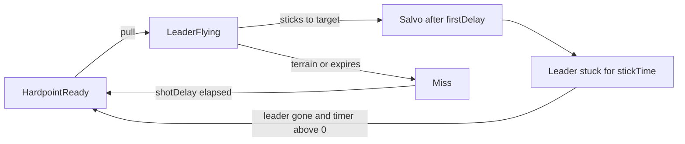

# Weapons Lab revisit

Every rule below names what it follows: an ODF value, a guide line (`docs/reference/odf-properties-guide.md`), or an engine address from the decrypted dump (`_investigation/output/bz2.asm`). Anything that is a presentation choice rather than engine behaviour is marked "renderer choice" in the code and in the docs.

## 1. Start distance from engagement reach and target size

What's wrong today:
- **Mauler vs ISDF Factory.** Not fixed. The spawn floor is `ceil(shipR + 0.35*diag)` = 40 m in [js/weapons-range.js](js/weapons-range.js) (`minDistance`, `loadTarget`). That leaves the Mauler's nose about 3.5 m from a building with a 32 m half-depth. Closing then drives to `CLOSE_STOP_M` = 20 m from the target's origin, which is inside the building.
- **TAG.** It opens at 0.45 × 500 m (the swarmer's flight reach) = 225 m. That is beyond the 175 m the leader round can reach (`leadervsr_c` 200 m/s × 0.875 s).
- **Shadower.** The range already opens it at 90% of `lockRange` 200 = 180 m. But the result card, Closing and the weave all use its 800 m flight range.

Fix:
- Add one pure `engagementReach(profile)` helper in [js/weapons-weave.js](js/weapons-weave.js), which already owns reach. It returns:
  - Launchers: LauncherClass `lockRange` (guide 7554-7595).
  - TAG: the leader's `shotSpeed × lifeSpan`.
  - Lobbed weapons: the existing aiRange / ballistic reach.
  - Everything else: the ordnance's `shotSpeed × lifeSpan`.
- Give the calculator and the profile the same `lockRange` default. Today [js/weapons-calc.js](js/weapons-calc.js) line 471 has none, while [js/fx/weapon-profile.js](js/fx/weapon-profile.js) line 687 falls back to `shotSpeed × lifeSpan`.
- Measure distance to the target's **surface**:
  - `shipFront` is the hull box face along the forward axis, or the muzzle if that is further forward.
  - `targetDepth` is the face of the target's GLB box along the approach ray, including the box's centre offset. That box is the one the `.msh` header bakes around the visible geometry (Models rule).
  - The no-overlap floor is `shipFront + targetDepth + margin`.
- Opening distance:
  - Launchers keep 90% of `lockRange`, measured to the centre (the existing memdump rule).
  - TAG opens at 90% of leader reach, measured to the surface, because the leader has to touch the hull.
  - Direct fire opens with a gap of `START_REACH_FRACTION` (0.5, renderer choice) × reach to the surface.
  - Example: the Mauler opens 25 m from the factory face, about 61 m centre to centre.
- Closing stops at the floor plus `CLOSE_STOP_M`, measured to the surface.
- The target's hit volume becomes the same box, tested in the target's local frame, instead of `segmentHitsSphere` on a 0.35 × diagonal sphere. The sphere stays as a fallback when there is no box. This keeps "in reach" and "it hits" consistent.
- The UI shows both distances, e.g. "61 m (25 m to hull)", and replaces the "Distances are to the target's centre" note. The result card's Range row shows engagement reach and flight reach as separate values.

## 2. Lock time depends on the target's signature

Evidence:
- **GameObjectClass loader** (`0x0056E1B8` / `0x0056E212` / `0x0056E26C`) stores the three signatures on the class: `imageSignature` at +0x7E8, `radarSignature` at +0x7EC, `heatSignature` at +0x7F0.
- **Per-launcher accumulate** (vtable slot +0x16C):
  - Base LauncherClass (`0x0061E173`): `+= dt`.
  - ImageLauncher (`0x0061CB33`): `+= imageSignature × dt`.
  - RadarLauncher (`0x00621A17`) and TorpedoLauncher (`0x00626AC9`): `+= radarSignature × dt`.
  - ThermalLauncher (`0x00626553`): `+= heatSignature × dt`.
- **Stage interval:** `lockDelay / targetCount` (`0x0061E6CD`). The lock completes at stage `targetCount − 1` (`0x0061E2AE`).
- **Guide:** lines 1590-1597 say what each signature controls; all three default to 1.0.

Formula: `lockTime = lockDelay × (targetCount−1) / targetCount / signature`. A signature of 0 means the lock never completes.
- Shadower (base 1.0 s): Scout (image 3.0) 0.33 s, ISDF Tank (2.5) 0.40 s, Factory (1.0) 1.0 s, Scion Artillery (0.1) 10 s.
- Hornet (thermal, base 1.33 s): Scout (heat 0.5) 2.7 s, Scavenger (5.0) 0.27 s.
- Mini-Comet (radar, base 0.33 s): never locks the Scion Artillery (radar 0.0).

Changes:
- [js/fx/weapon-profile.js](js/fx/weapon-profile.js) records which signature a weapon locks with, from its class chain. MultiLauncher derives from ImageLauncher (guide 7696), so it uses the image signature. I could not confirm this in the engine: the vtables are only built at runtime, so they are not in the static dump. The docs will say so.
- The target ODF's three signatures (with inheritance, default 1.0) go into the sim.
- [js/fx/weapon-sim.js](js/fx/weapon-sim.js) (lock update, around line 1800) divides `acquire` by the signature.
- During implementation, check whether leaving the cone counts as a target change. The engine resets accumulation and stage on a target change (`0x0061E26E`). If it does, the current 1/s drain becomes a reset.
- Add `lockTime(variant, target)` to the calculator. The card's "Lock-on" row in [js/weapons.js](js/weapons.js) (around line 1385) shows the time for the chosen target and names the signature used, instead of the raw `lockDelay`. The launcher note at line 814 is updated to match.

## 3. Fang: one burst, sound starting at once

ODF: `gquill_a` has `salvoCount` 15, `salvoDelay` 0.001, `shotVariance` 0.5 and fires from 2 hardpoints. Its ordnance `quill_a` has `shotSound` `gquil03.wav`, and the weapon's `fireSound` is `chaff01.wav`.

Engine:
- **Salvo catch-up loop** (`0x0061920D` adds dt, `0x00619276`-`0x006195A3` fires): `while timer >= 0 && left > 0 { fire; timer -= salvoDelay; left-- }`. All 15 rounds leave in the same 50 ms turn. The salvo stops early when ammo runs out (`0x0061929F`).
- **fireSound:** one sound handle per weapon instance (`+0x4C8`). With `SoundPerShot` 1 the engine starts at most one new `fireSound` per turn: the first round of the turn starts it (`0x00619228`), and later rounds skip it while it plays (`0x0061931F`). `SoundPerShot` 2 or `OnlyOneSound` (class +0x790) stops the old sound and replaces it (guide 7348-7352). Only `glockvsr_a` sets `OnlyOneSound`.
- **shotSound:** every round plays its own ordnance `shotSound` (`0x00669152`-`0x006691B0`).
- **Spread** (`0x006274BD`): pitch = table[i] × variance − shotPitch, yaw = table[i+1] × variance. That is what `applyCone` already does, so the cone maths stays.

Changes in [js/fx/weapon-sim.js](js/fx/weapon-sim.js):
- Replace both salvo branches (the `delay <= 1e-6` dump and the one-round-per-frame branch with a timer reset, lines 1955-1976) with the engine's banked loop.
- `fireMuzzles` starts at most one `fireSound` per step. Parse `OnlyOneSound` and `SoundPerShot` 2 in the profile and use stop-and-replace for them.
- Collapse identical `shotSound` starts within one step into a single voice. This is a renderer choice: 30 identical copies starting at once only add volume and clip in Web Audio. The engine plays all 30.
- The variance maths is untouched. The "stream" look came from rounds leaving on different frames, so once all 30 pellets leave in one step the burst reads as one cone.

## 4. TAG in the sim

ODF: `gtaggunvsr_c` has `shotDelay` 0.5, `firstDelay` 0.5, `salvoDelay` 0.2, `salvoCount` 6, leader `leadervsr_c` (`stickTime` 4.0) and ordnance `swarmervsr_c`.

Engine:
- **Loader** (`0x00625F61`-`0x006260A4`) reads `leaderName`, `leaderSound`, `shotDelay`, `firstDelay`, `salvoDelay` and `salvoCount`.
- **Fire gate** (`0x00625A9A`): a hardpoint fires a leader only when it has no live leader **and** its timer is above 0. Firing then subtracts `shotDelay` from the timer.
- **Arming** (`0x00625C63`): a leader carrying the stuck flag sets `salvoLeft = salvoCount` and `timer = −firstDelay`. A leader that no longer exists clears the hardpoint.
- **Salvo** (`0x00625813`-`0x00625A1B`): the same catch-up loop as the cannon.
- The salvo state lives on the weapon instance, not on the trigger.

Changes in [js/fx/weapon-sim.js](js/fx/weapon-sim.js):
- A leader that hits the ground counts as a miss, with no salvo. Today lines 1632-1645 start a salvo on a terrain hit.
- Each tag field captures its own weapon's profile, ordnance, `fireSound` and hardpoint when it is created. Today it reads the global `profile`, which a weapon switch swaps.
- The tag salvo timer banks like the cannon's (fixes the reset at line 1671).
- Re-tag rule: the default `TAG_RETAG_AFTER = 'leader'` is the engine read (wait for the stuck tag to drop, about 4 s after a hit). `'salvo'` is available as a one-line switch.
- Switching weapons keeps leaders, tag salvos and rounds already in flight. Reset and changes of ship or target still clear everything. The weave already swaps `profile` mid-flight without clearing, so rounds already tolerate it.

## 5. TAG under weapon switching (Chain + TAG)

- Remove `targeting` from `EXCLUDED` and add it to `WEAVE_ARCHETYPES` in [js/weapons-weave.js](js/weapons-weave.js).
- The targeting pull returns true when a leader fired. Today the bare `return;` at line 1273 means `fireSlot` never registers it.
- A TAG pull costs one pull with `busy = 0`, because the missiles are automatic.
- Its `readyAt` comes from the live per-hardpoint state above. When it is ready it goes first, so the trigger otherwise stays on the chain gun.
- The analytic planner (`weaveWeapon` / `planWeave`) models one TAG cycle as follows:
  - Cycle length = leader flight + `stickTime`, or + the salvo time under `'salvo'`.
  - Damage per cycle = `salvoCount` × swarmer damage for the target's class, per hardpoint.
  - Missiles land at hit + `firstDelay` + k·`salvoDelay` + flight.
  - There is no damage when the target is outside leader reach.

## 6. First person uses `hp_eyepoint` (already), hardened

- The range already uses it: `placeCamera` calls `viewer.eyepointWorld()`, which looks for the exact name and then the prefix (`_findEyepointNode`, [js/models-viewer.js](js/models-viewer.js) lines 1867-1875). 67 of 75 vehicle and pilot GLBs carry it.
- The explorer matches exact names only (`hp_eyepoint` / `hp_eyepoint_1`, [js/explorer/ship-controller.js](js/explorer/ship-controller.js) line 314). It moves to the same prefix lookup, which also catches `hp_eyepoint5` / `hp_eyepoint6`.
- Keep the fallback for the 8 GLBs that have no eyepoint (for example `fvrckt00`, `evrecy00`, `fvrecy00`).
- Fix the stale `run_cockpits()` docstring in [scripts/object-render/convert_msh.py](scripts/object-render/convert_msh.py): it claims the range subtracts the box centre, and it does not.

## 7. GUI: one Shooting range page plus Damage matrix

- [weapons/index.html](weapons/index.html) keeps two pills: **Shooting range** (the default, no `tab` param) and **Damage matrix** (`tab=matrix`). Old `tab=scenario` and `tab=range` links both open the range (`readUrl` / `writeUrl` in [js/weapons.js](js/weapons.js)).
- A picker strip above the stage holds three summary buttons:
  - Ship: thumbnail and deploy state.
  - Weapon: reticle and variant.
  - Target: thumbnail, armour or shield letter, and its signatures.
- Each button opens a Bootstrap offcanvas that reuses `renderChips` / `renderList` / `renderControls(kind)` instead of a copy of them.
- `renderResult` moves into a collapsible "Numbers" panel under the stage, with its open state stored in `localStorage` `vt.wpn.numbersOpen`.
- The range mounts at boot unless the page opens on the matrix, so three.js loads only for the range.
- Range hotkeys (Space, 1-5) are ignored while focus is in a drawer input.
- Empty-state copy points to the strip ("Pick a ship above").
- The new strip, drawers and Numbers panel are built from Bootstrap from the start (`btn-group`, `offcanvas`, `collapse`, `card`).

## 8. Theme and Bootstrap pass over the whole Weapons Lab

Audit of the current state:
- [css/weapons.css](css/weapons.css) (1640 lines, 146 `vt-wpn-*` classes) has no hex or `rgb()` colours; every colour is a `--kb-*` variable.
- The Scenario pickers already use `card`, `card-header` and `list-group-item-action`.
- The rest is hand-built where Bootstrap has a component, and so misses the theme layer's glass styling of `.card`, `.table` and `.nav-pills` in [css/vtstats-theme.css](css/vtstats-theme.css). That covers most of the range, the chips and tags, and the matrix.
- The only colour literals in the JS are game data, not UI chrome, and they stay:
  - The ODF rave-flash colour (`weapons-range.js` line 406).
  - The game HUD's yellow-then-red lock circle (`weapon-sim.js` lines 123-124).
  - White texture and light multipliers in three.js.
- The inline styles in [weapons/index.html](weapons/index.html) are the canonical topnav snippet and stay as copied.

Swaps (CSS, markup, and the JS string builders in [js/weapons.js](js/weapons.js) and [js/weapons-range.js](js/weapons-range.js)):
- Filter chips `.vt-wpn-chip` become `btn btn-sm` toggle buttons. The faction tint stays as a `--kb-faction-*` variable on the button.
- Tags and tier badges (`.vt-wpn-tag`, `.vt-wpn-tier`) become `.badge` on `--kb-*-muted` backgrounds with `text-*`, per the styling rule.
- Hardpoint chips `.vt-wpn-hp` become `btn btn-sm btn-outline-secondary`, using `active` for the picked group.
- Range controls:
  - The bare checkboxes (Weapon switch, Moving target, Cockpit, Closing) become `form-check` / `form-switch`.
  - The distance and volume sliders become `form-range`.
  - The labelled inputs become `input-group-sm`.
- The ammo, hull and lock meters (`.vt-wpn-range-meter`) become thin `.progress` / `.progress-bar`.
- The HUD cards, loadout slot cards and weave panel become `card` / `card-body`, so they pick up the theme's glass and light-mode overrides with no custom code.
- The weave priority list becomes a `list-group` with `btn-group-sm` up and down buttons.
- The stats table `.vt-wpn-stats` and the Damage matrix become `table table-sm table-hover`; the sticky header and first column stay.
- The status line and notes (`#vt-wpn-status`, `.vt-wpn-notes`, `.note-warning`) become `alert` on muted theme variants.
- Monospace text uses the `.vt-mono` utility instead of four local `font-family` rules. Hardcoded transitions (`0.15s ease`) use `--vt-anim-duration` / `--vt-anim-ease`, so reduced motion applies.
- Domain-only widgets keep their custom CSS, on theme variables: the armour/shield strip, reticle frames, the weave ribbon and the 3D HUD overlay positions.
- Delete the `vt-wpn-*` rules each swap makes dead. Keep the class names a gate or another page reads.
- Checks:
  - Visually check dark and light mode and two or three themes.
  - Check one narrow (mobile) width.
  - Grep the Weapons Lab UI files for new colour literals; the game-data exceptions above are the only ones allowed.

## Gates (gitignored)

- [_investigation/check_weapons_calc.mjs](_investigation/check_weapons_calc.mjs):
  - Lock times per target (the values above, including "never").
  - Engagement reach: Shadower 200 m, TAG 175 m, Fang 50 m.
  - The calculator and the profile agree on the `lockRange` default.
- [_investigation/check_weapon_fx.mjs](_investigation/check_weapon_fx.mjs):
  - Fang's 30 rounds leave in one step, with one `fireSound` per step.
  - A TAG ground hit starts no salvo.
  - A tag field survives a profile swap, and its salvo banks.
  - Start distance: the Mauler vs the Factory does not overlap and is within reach, the Shadower opens at 180 m, and the TAG opens within 175 m of the surface.
- [_investigation/check_weapon_weave.mjs](_investigation/check_weapon_weave.mjs):
  - Line 112 changes from "`gtagcr_c` refused" to "planned".
  - Chain + TAG on `ivscout_vsr` puts at least 95% of pulls on the chain gun.

## Docs

- `DEVELOPER_GUIDE.md` §12 (Weapons Lab and Shooting range):
  - Distance rules (replacing lines around 1976 / 1978 / 1982 / 1992 / 2019).
  - Lock formula with the engine addresses.
  - Salvo loop and sound rules.
  - TAG state machine.
  - Tab merge and aliases.
- `.cursor/rules/project-overview.mdc`: Weapons Lab item 12 ("Two tabs" becomes Shooting range + Damage matrix; the "Shooting range tab is the third pill" text) and the Key File Locations bullet.

Not changing: torpedo launchers. The engine gives them a radar-signature lock, but the sim launches them without one; that stays a noted follow-up.