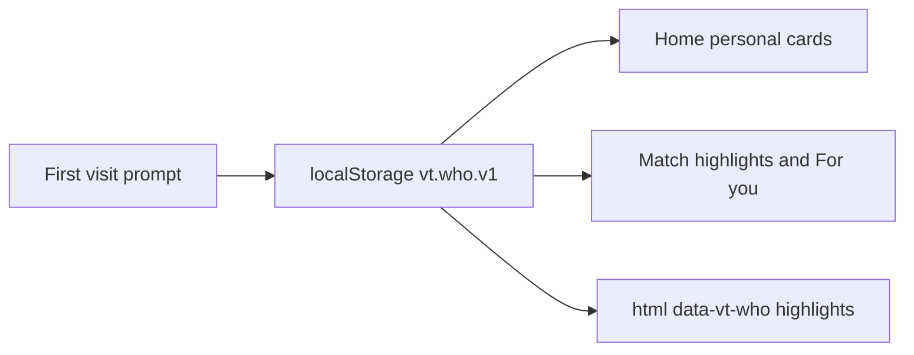

# Who this browser follows

A one-time prompt stores a Steam64 in localStorage. The site does not sign anyone in, and anyone in the corpus can be picked. The stored id is what later pages read. A cached display name and slug ride along so the gear can label itself without downloading the rating files on ODF, Models, or the map stubs.

## Identity module

New [`js/who.js`](js/who.js), exposed as `window.VTWho`. [`js/cursor-settings.js`](js/cursor-settings.js) assigns a synchronous stub at the start of its IIFE (localStorage read only), then inserts `who.js` with `async = false`. That covers every shell and both pre-generated templates without a template-version bump, including pages whose own script runs before the gear.

Record shape:

- `status`: `set` or `skipped`
- `steam64`: the only identity. Alias sources store the target id from `player_slugs.json` `alias_of`
- `name`, `slug`: display cache, refreshed whenever a page already has the slug map or a rating file
- `setAt`

`Not now` and Clear both write `skipped`, so the modal does not return. Change reopens the picker. A future copy change re-asks only by bumping the key to `vt.who.v2`. Private-mode storage failures are ignored, same as the gear.

The modal is injected, same pattern as the About modal. It opens once on the first top-level page when `status` is missing. It does not run in an iframe, and it waits out pointer lock. Backdrop and Esc do nothing. The list is fetched only when the modal opens (`elo_current.json`, `elo_commander_current.json`, `player_slugs.json`). If that fetch fails, the dialog says so and still offers Not now.

Search pool is the union of those three files, which is every player the corpus can name by Steam64:

- every VTSR-T row, including provisional, inactive, and a single rated game
- commander rows that are not in the thug file (community-ledger commanders included)
- stale slug entries kept after someone leaves the rating pool

Alias sources are hidden. `data/steamid_to_name.txt` stays out: those names have no match row to personalize. Someone who appears only as an unrated leaderboard row (never a rated thug game and never a commander duel) is not in these files, so they are not searchable. The picker still has to tolerate a chosen player whose thug rating, commander rating, or both are missing.

Each result shows the name, a thug band chip or “No thug rating”, a VTSR-C number only when they have one, rated-game counts, and an inactive chip when `inactive_status` is `inactive`. The list is A–Z. Typing filters prefix, then substring. VTSR-T is never printed as a number.

Gear row, under About: **You · F9bomber** with Change, or **Set who you are** when skipped. Clear returns the home page to the rising lists.

`document.documentElement.dataset.vtWho` is the Steam64. One injected stylesheet highlights any existing `[data-steam64]` or `[data-vtsr-steam64]` that matches, and uses `:has()` so the enclosing table row, roster chip, and highlight tile pick up the same treatment. A small **You** chip is `::after` content on the link. No re-render is required on the ELO ladders or the Players hub, because those rows and cards already carry the attribute ([`js/elo.js`](js/elo.js) VTSR-T rows, [`js/player.js`](js/player.js) directory cards).

## Home page

The bottom row in [`index.html`](index.html) stays three cards. Meta is unchanged. With someone set, [`js/landing.js`](js/landing.js) replaces Rising commanders and Rising thugs. A **Show climbers** control in the card head writes `sessionStorage` `vt.who.homeView=community` and restores the rising lists for this tab. **Show me** switches back. The KPI row stays corpus-wide.

Thug card, from the `elo_current` row when one exists:

- name, band chip (or “Provisional” / “No thug rating yet”), profile link
- last-10 pills from `win_history`, using `VTSRDisplay.deltaVerdict` (fewer pills when the history is short)
- “Last played {relative time} · {map}” by joining `last_match_id` to the manifest already in memory
- rated-game count; if inactive, “Last seen {date}”

Command card, from `elo_commander_current` when one exists:

- VTSR-C, W–L–D, provisional mark when `provisional`
- “Last commanded {date}” from `last_command_date`, plus the map when `last_match_id` is a real match id. An `f9:` sentinel is labeled as a community-ledger game, with no invented map
- last-10 result pills from that file’s `win_history`

When they have no commander row, the second card is their four most recent manifest matches. `matches.json` `players` is display names, so this joins on the cached name. A rename hides older games. `team_leaders` marks a row they commanded. The same mark lands on the existing Latest matches list.

Both cards always render. Missing ratings become an honest line, never a placeholder 1500 and never a blank slot. Styles stay in [`css/landing.css`](css/landing.css) and reuse the current rise-row rhythm so `fitRising` still fits the viewport.

## Match page

### Highlights

Add `data-steam64` at the name chokepoints that do not have it yet, so the shared stylesheet does the rest:

- [`vtPlayerLinkHtml`](js/app.js) (leaderboard, economy sub-rows, rivalries, Balonce chips, highlights)
- kill-feed killer, victim, and assist anchors in `renderKillFeed` (they build their own links today)
- accuracy-table rows and movement-leaderboard rows ([`js/positioning-charts.js`](js/positioning-charts.js) currently prints a plain name)
- [`js/storyline.js`](js/storyline.js) `playerLinkHtml`
- [`js/elo.js`](js/elo.js) `playerLinkHtml`, which also covers the commander ladder (those `<tr>`s have no steam attribute today)
- map Top Commanders rows in [`js/maps.js`](js/maps.js)

The per-match player filter is left alone. Highlighting a row does not hide the lobby.

Gallery cards in [`js/app.js`](js/app.js) get a **You played** mark, and **You commanded** when `team_leaders` matches, using the same name join as the home list.

On a profile, [`js/player.js`](js/player.js) adds a **This is you** chip on the title strip when the open Steam64 matches. The hub card highlight falls out of the stylesheet.

### For you pill

New pill and pane in [`matches/index.html`](matches/index.html), immediately left of Overview. Slug `you` added to `MATCH_TAB_SLUGS` in [`js/app.js`](js/app.js). The `<li>` stays `d-none` until the followed player has a leaderboard row in the open match. Overview remains the default tab. Deep link `?tab=you` opens it when the pill is visible and bounces to Overview otherwise.

New [`js/match-you.js`](js/match-you.js) (`window.VTMatchYou`), loaded next to [`js/match-elo.js`](js/match-elo.js). `renderMatchData` calls it with the unfiltered match. It reads data the match page already has. No new JSON, no `PIPELINE_VERSION` bump. Cards self-omit, and each card’s title is a button that activates the existing pill.

- **Result.** Their team’s win, loss, draw, or unclear, from `match.winner`. Role line: Commander or Thug, faction, primary ship.
- **Rating.** Thug: band before and after plus Beat expectation / On par / Below expectation from the `elo_history` delta. The number stays off the screen. Excluded rows (campod, partial, idle) say why there is no delta. Commander: VTSR-C before, after, and delta when this match has a duel. A 1v1 or 2v2 line only when that history file has a row for this match and this player. Empty when the match was not rated and they have no duel.
- **Combat.** Kills, deaths, enemy damage, and any highlight card they won.
- **Economy.** Commander: their side’s income, loose collected, ships built, combat-ship value, from `economy.teams` and `thug_supply.commander_row`. Thug: their `thug_supply.thugs[]` row (ships lost, time on foot, re-ship). Hidden when the match has neither economy nor a supply row for them.
- **Movement.** Activity score, band, time in base, path length, from `positioning.players[name]`.
- **Weapons.** Shots, accuracy (em dash when the match has no bullet hits), top weapon, T-key percent when recorded.
- **Rivalries.** The player they dealt the most to, and the player who dealt the most to them.

A spectator or a one-line leaderboard row still gets the pill. The empty cards drop out, and the header says what they were (spectating, partial, no rated delta).

## Pages this pass does not rewrite

The gear and the highlight stylesheet still apply everywhere.

- Game Watch and Tools: a lobby row can light up later if it grows `data-steam64`. Do not auto-seat them on Team Balonce.
- Meta, ODF, Models, Weapons, Explorer, LEGO, guides: nothing on those pages is per-player. The gear is the whole feature there.
- Discord unfurls and shared URLs stay anonymous. The choice never enters the query string.

## Docs and checks

No schema bump. A short subsection in [`DEVELOPER_GUIDE.md`](DEVELOPER_GUIDE.md) records the storage key, the “VTSR-T stays a band” rule on the new surfaces, the name-join limit on the manifest, and that For you is match-global and ignores the player filter.

Browser check, desktop and a narrow viewport: first-visit modal, pick a ranked player and a player with no commander rating, home cards and Show climbers, a match they played (highlights plus For you, including an economy card when they commanded), a match they did not play (pill hidden), Clear from the gear, and the ELO row plus a profile chip lighting up from the stylesheet alone.
