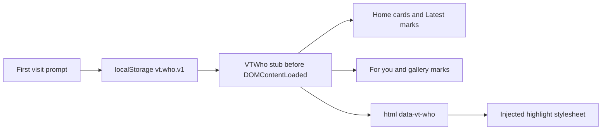

# Who this browser follows

A prompt stores one Steam64 in `localStorage`. The site does not sign anyone in. Anyone the three corpus files can name can be picked. Later pages read that id. A cached display name, slug, and name list ride along so the gear can label itself, and so the home page and the match gallery can mark games, without downloading the rating files on ODF, Models, or the map stubs.

No pipeline change, no `PIPELINE_VERSION` bump, no new JSON file. `?who=` stays the legacy Experimental-tab redirect in `redirectLegacyAllTab()`. This feature never reads or writes that parameter, and the choice never enters the query string. Shared links and Discord unfurls stay anonymous.

## Identity module

[`js/cursor-settings.js`](js/cursor-settings.js) already loads on every shell and both pre-generated templates, and it already refuses a second pageview inside an iframe. Extend that IIFE:

1. On the first line, read `localStorage` and assign `window.VTWho` to the stub below. Set `document.documentElement.dataset.vtWho` to the Steam64 when `status` is `set`. Remove the attribute otherwise.
2. Build the gear as it does today.
3. On the last line, insert [`js/who.js`](js/who.js) with `async = false`. Resolve the URL from this script’s own `src` (`new URL('who.js', SCRIPT_URL)`), the same way the cursor sprite is resolved. A page at `/map/<slug>/` must not fetch a relative `js/who.js`.

That insertion does not block `DOMContentLoaded`. Every boot that personalizes (`landing.js`, `app.js`, `player.js`, `elo.js`) already waits for `DOMContentLoaded`, which fires after `cursor-settings.js` has set the stub. Those boots call the stub. They register a `vt-who-change` listener at the top of the IIFE, during parse, so the listener exists before `who.js` can open the picker. `who.js` replaces the stub with the full object and keeps every method name.

Stub methods, all synchronous:

- `get()` — the stored record, or `null`
- `status()` — `set`, `skipped`, or `''`
- `steam64()` — the id, or `''`
- `names()` — the cached name list
- `played(entry)` — true when any cached name is an exact element of `entry.players`
- `commanded(entry)` — true when `entry.team_leaders['1'|'2'].s64` string-equals the id

`who.js` adds `open()`, `clear()`, and `set(steam64)`. It dispatches `vt-who-change` on `document` after every write, including a write that arrives from another tab through the `storage` event. `detail` is `{ status, steam64, name, slug, names }`.

### Record

Key `vt.who.v1`. Shape:

- `status`: `set` or `skipped`
- `steam64`: string. The only identity. Alias sources store the target id from `player_slugs.json` `alias_of`. Never coerce with `Number` — a Steam64 is larger than `MAX_SAFE_INTEGER`.
- `name`, `slug`: display cache
- `names`: `name`, plus the `elo_current` / `elo_commander_current` name when one of those rows is already in memory, plus every slug-map `name` whose `alias_of` is this id. Refreshed whenever a page already has the slug map or a rating file. Exact, case-sensitive.
- `setAt`: ISO timestamp

A stored `set` record whose `steam64` is not 17 digits is treated as missing, and the prompt shows again. `skipped` ignores any leftover id and clears `data-vt-who`.

`Not now` and Clear both write `skipped`, so the automatic prompt does not return. Change reopens the picker and leaves the current record in place until a new row is chosen. A future copy change re-asks only by bumping the key to `vt.who.v2`.

If `localStorage` throws, the prompt says this browser is not saving the choice, `sessionStorage` `vt.who.sessionDismiss` suppresses the prompt for the rest of the tab, and the site behaves as if nobody is set.

### Picker

Injected, same pattern as the About modal. It opens on its own once, on the first top-level page whose `status` is missing. It does not open in an iframe. If `document.pointerLockElement` is set, it waits for `pointerlockchange`.

Two modes:

- Automatic open, and a gear open while `status` is still missing: backdrop and Esc do nothing. The ways out are a picked row or Not now.
- Gear open when `status` is `set` or `skipped`: backdrop and Esc close the dialog and write nothing.

The list is fetched only when the dialog opens, from URLs resolved off `who.js`’s own `src`: `../data/processed/elo_current.json`, `elo_commander_current.json`, `player_slugs.json`. A 404 is an empty list. A network failure of all three shows one sentence and a Retry button, and still offers Not now. Pages that already fetched these files may fetch them again; the browser cache is enough. There is no shared prime API.

Search pool is one row per Steam64, the union of those three files:

- every VTSR-T row, including provisional, inactive, returning, and a single rated game
- commander rows absent from the thug file, community-ledger commanders included
- slug-map entries, including `matches_played` of 1 and entries kept after someone leaves a ladder

Alias sources (`alias_of` set) are hidden. `data/steamid_to_name.txt` stays out. A person who is in none of the three files is not searchable. The home cards and For you still tolerate a chosen player who has a thug row, a commander row, neither, or both.

Each result shows the display name (thug row, else commander row, else slug name), a thug band chip from `VTSRDisplay.bandFor` when a thug row exists, the word “No thug rating” when it does not, a “Provisional” chip when `matches_provisional` is true, a VTSR-C number (`Math.round`) only when a commander row exists, rated-game counts, and an “Inactive” or “Returning” chip from `inactive_status`. The unfiltered list is A–Z. Typing ranks prefix matches of the name, then substring matches, each group A–Z. A query of 8 or more digits also matches the Steam64. Render at most 100 rows and say how many are hidden. VTSR-T is never printed as a number. Up and Down move the highlight, Enter selects, and the query field keeps focus.

### Gear

A row under About.

- `set`: **You · {name}**, with Change and Clear. Clear writes `skipped` immediately, with no confirm, and removes `sessionStorage` `vt.who.homeView`.
- `skipped` or missing: **Set who you are**.

### Highlight stylesheet

`who.js` injects one `<style>` element. The Steam64 is interpolated only after the 17-digit check. Colors come from `var(--kb-*)` and `color-mix`, the same way `css/landing.css` already mixes. There is no new CSS file and no template-version bump.

The wash hits the node that carries the id and the row around a link:

- `a[data-steam64]`
- `[data-vtsr-steam64]` (the VTSR-T `<tr>` in [`js/elo.js`](js/elo.js) already has this)
- `tr[data-steam64]`, `tr:has(a[data-steam64])`
- `.vt-player-card[data-steam64]`, `.vt-compare-mini-card[data-steam64]`
- `.vt-highlight-tile:has(a[data-steam64])`
- `.gw-prow[data-steam64]` and `.vt-active-game-modal-player-row[data-steam64]` (Game Watch, the home Online now card, and the Tools live-session card already emit these)

A **You** chip is `::after` on `a[data-steam64]` and `a[data-vtsr-steam64]` only. Row divs get the wash and no chip. Replacing the style tag is the whole update; ladders do not re-render when the id changes.

Stamp `data-steam64` in every helper that already has the id and does not yet emit it:

- [`vtPlayerLinkHtml`](js/app.js) — leaderboard, economy sub-rows, rivalries, highlights on the match page, and anything that delegates to it ([`js/match-elo.js`](js/match-elo.js), [`js/balonce-meter.js`](js/balonce-meter.js))
- the kill-feed killer, victim, and assist anchors in `renderKillFeed` (they build their own links)
- the highlights fallback in [`js/highlights-render.js`](js/highlights-render.js), the hub `link()` in [`js/players-hub.js`](js/players-hub.js), and `playerLink()` in [`js/players-tab.js`](js/players-tab.js)
- [`js/storyline.js`](js/storyline.js) `playerLinkHtml`, [`js/elo.js`](js/elo.js) `playerLinkHtml` (commander, 2v2, and 1v1 ladders included), [`js/meta.js`](js/meta.js) `playerLinkHtml`
- accuracy-table `<tr>` and movement-leaderboard `<tr>` from the leaderboard row’s `steam64` ([`renderAccuracyTable`](js/app.js), [`renderMovementLeaderboard`](js/positioning-charts.js)). Those name cells stay plain text. The wash is the `<tr>`.
- map Top Commanders anchors in [`js/maps.js`](js/maps.js)
- compare mini-card and its name link in `renderCompareHeroCard`

Directory cards in [`js/player.js`](js/player.js) already carry `data-steam64`. Leave them.

The per-match player filter is unchanged. A washed row stays in the lobby.

The Tools Team Balonce roster is left without the attribute. Nothing auto-seats the followed player.

## Home page

The bottom row in [`index.html`](index.html) stays three cards. Meta is unchanged. The KPI row, the hour chart, and Online now stay corpus-wide. Online now picks up the wash for free because its roster rows already have `data-steam64`.

[`js/landing.js`](js/landing.js) already loads `elo_current`, `elo_commander_current`, the slug map, and `matches.json`. Personal cards read those payloads and `VTWho`. They do not fetch again.

When `status` is `set` and `sessionStorage` `vt.who.homeView` is absent, the two rising cards become the thug card and the command card. Both heads grow a `You | Climbers` pill pair bound to that key (`community` shows the rising lists and restores the Rising titles and the ELO links). Either card’s pills update both cards. Choosing a different person, or Clear, deletes the key. `fitRising` only counts `.vt-home-rise` rows, so the personal markup simply does not use that class and does not call `fitRising`. Keep each personal card to about four lines; the card body already scrolls inside the fitted grid.

Thug card, from the `elo_current` row when one exists. Call `VTSRDisplay.setConfig` on that file first.

- name, profile link, band chip
- a Provisional chip when `matches_provisional` is true (the file’s `provisional_threshold` is 10; the boolean is the field)
- an Inactive or Returning chip from `inactive_status`
- last-10 pills from `win_history` through `VTSRDisplay.deltaVerdict`, one pill per stored delta, omitted when the history is empty
- one line: active players get “Last played {relative} · {map}”; inactive and returning get “Last seen {last_seen_date} · {map}”. Join `last_match_id` to `manifest[].id`. A missing id drops the map. Rated-game count sits on the same line.

No thug row: the name, the profile link, and the sentence “No thug rating yet”.

Command card, from `elo_commander_current` when one exists:

- VTSR-C, W–L–D from `wins` / `losses` / `draws`, a provisional mark when `provisional` is true
- “Last commanded {last_command_date}”. A real `last_match_id` adds the manifest map name. An id starting with `f9:` reads “Community ledger” and links to `https://f9bomber.com`. No map is invented.
- last-10 pills from that file’s `win_history`, colored by the sign of the VTSR-C delta (up, flat, down), the same reading as the rising-commander pills. The number is the rating at the top of the card, not a caption on each pill.

No commander row: the title stays Command, the body is “No commander rating yet”, then up to four most recent manifest matches from `played(entry)`. Zero joined matches leave the sentence on its own.

Latest matches, the existing four, get one mark. `commanded(entry)` prints “You commanded”. Otherwise `played(entry)` prints “You played”.

`matches.json` `players` is display names, so “You played” is the cached name list. A rename whose old nick is in neither the slug map nor an alias source stays unmarked. “You commanded” uses `team_leaders.*.s64` and does not have that hole. This pass does not add Steam64s to the manifest.

## Match page

### Gallery and profile

Gallery cards are built once. Stamp them the way `stampPickerVodMark` already stamps the VOD icon: `stampPickerYouMark` runs from `applyPickerFilters`, and `vt-who-change` calls that filter pass again. The mark sits in `.vt-match-picker-card-title`. Same commanded-then-played rule as Latest matches.

On a profile, [`js/player.js`](js/player.js) adds a **This is you** chip in `.vt-player-title-chips` when `window.__vtPlayerBoot.steam64` string-equals `VTWho.steam64()`. An alias-source profile stays unmarked. The chip is real text. `vt-who-change` adds or removes it. The hub card wash falls out of the stylesheet.

### For you pill

New pill and pane in [`matches/index.html`](matches/index.html), the first pill, before Overview. Markup only: `<li id="tab-you-li" class="nav-item d-none">`, `#tab-you-btn`, pane `#tab-you`. Slug `you` added to `MATCH_TAB_SLUGS` in [`js/app.js`](js/app.js). Overview remains the default and keeps `active` in the HTML. Showing the pill does not select it.

The pill is shown when the unfiltered `currentData.leaderboard` has a row whose `steam64` string-equals the followed id, including a camera-pod row. It stays hidden on the gallery and on a match with no such row. Switching to a match that hides the pill while the pane is active bounces to Overview, the same bounce the Economy pill uses. `?tab=you` opens the pane when the pill is visible. Otherwise the slug misses `activateTabFromSlug` and Overview stays up; the next `syncUrl` drops the slug.

New [`js/match-you.js`](js/match-you.js) (`window.VTMatchYou`), loaded next to [`js/match-elo.js`](js/match-elo.js). `renderMatchData` calls `VTMatchYou.render(currentData)` with the unfiltered match, never the filtered argument. The player filter does not hide the pill or change the cards. No new JSON.

Styles live in [`css/vtstats-theme.css`](css/vtstats-theme.css) under `.vt-you-*`.

A header line states the role from the leaderboard row: Commander, Thug, or Spectating (`is_campod`). It adds Partial (`is_low_activity`), Idle (`is_zero_damage` on a non-commander), or Benched when `match.bench.steam64` matches.

Cards self-omit, except Rating. Each card’s title is a button that activates the existing pill. Economy’s title is a button only while `#tab-economy-li` is visible.

- **Result.** Their team’s win, loss, draw, cancelled, or unclear, from `match.winner` compared with the row’s `team`. Faction from `match.team_factions`. Primary ship from `loadout.primary_ship.name`. Button: Overview.
- **Rating.** Always shown for a visible pill. Thug: band before and after via `VTSRDisplay.rawBandFor`, plus `deltaVerdict` on the `elo_history` delta already in `window.__vtEloHistory`. The number stays off the screen. A campod, partial, or idle row with no delta gets one sentence saying the row was left out of the rating. A benched row shows its real delta. A match-level exclusion (`draw`, `cancelled`, `no_winner`, `low_player_count`, `short_side`) uses the same plain sentences as `exclusionReasonText` in [`js/match-elo.js`](js/match-elo.js). Commander: VTSR-C before, after, and delta when `elo_commander_history` has a duel, read through `VTBalonce.ensureCmdrHistoryLoaded()` so the Outcome card and this pane share one request. A 1v1 line and a 2v2 line only when that history file has a row for this match and this player; those ladders print numbers. Fetch them 404-safe into the existing `window.__vtElo1v1History` / `__vtElo2v2History` slots if the match page has not already. Button: Elo.
- **Combat.** Kills, deaths, and `personal.enemy_dealt` when that field is a number. When it is absent, show `personal.dealt` labeled “Damage dealt”. Then the highlight labels they won: `highlights.cards[]` whose `winner.steam64` matches, plus a Frenemies card whose `winner.a` or `winner.b` equals the leaderboard name. Button: Combat. The card is omitted when every count is zero and they won nothing.
- **Economy.** Commander: their side of `economy.teams` — `scrap_income`, `income_loose` (say “collected”, lead with the scrap amount), `ships_built`, `combat_ship_value` — plus `thug_supply[team].commander_row` when ships lost or time on foot is non-zero. Thug: the `thug_supply[team].thugs[]` entry with the same Steam64 (ships lost, value lost, time on foot, re-ship). Hidden when the match has neither an economy side nor a supply row for them. Button: Economy.
- **Movement.** `positioning.players[leaderboard name]`: activity score, band, time in base, path length. The tooltip says the score is match-relative. Hidden when that entry is missing. Button: Movemint (`#tab-positioning-btn`).
- **Weapons.** Shots, accuracy (em dash when `has_bullet_hit_data` is false, same rule as `fmtAccPct`), top weapon by `weapon_breakdown[].dealt`, T-key percent from `positioning.players[name].metrics.target_lock_pct` when `has_target_lock_data` is true. Button: Weapons & Accuracy.
- **Rivalries.** From the unfiltered `rivalry_matrix`, which is keyed by leaderboard name. The name they dealt the most to, and the name who dealt the most to them. Links go through `vtPlayerLinkHtml`. Friendly fire stays in, because the matrix counts it. Hidden when both sides are empty. Button: Rivalries.

## Pages this pass leaves as they are

The gear, the dataset, and the highlight stylesheet still load everywhere `cursor-settings.js` loads.

- Tools Team Balonce keeps its own roster and does not gain `data-steam64`. The live-session card already has the attribute, so the wash reaches it.
- Meta, ODF, Models, Weapons, Explorer, LEGO, and the guides gain the gear and, where a player link was stamped above, the wash. No new blocks on those pages.
- The 3D replay iframe does not load `cursor-settings.js`. The iframe guard is what keeps a future embed from opening a second prompt.

## Docs and checks

A short subsection in [`DEVELOPER_GUIDE.md`](DEVELOPER_GUIDE.md) records the storage key, the stub-before-`DOMContentLoaded` rule, the “VTSR-T stays a band” rule on the new surfaces, the name-list limit on manifest `players`, the Steam64 join on `team_leaders`, and that For you reads `currentData` and ignores the player filter. One sentence in [`.cursor/rules/project-overview.mdc`](.cursor/rules/project-overview.mdc) under the browser-dashboard item points at that subsection. No filter-contract row: there is no new JSON field.

Browser check, desktop and a narrow viewport:

- first visit on the home page, Not now, then Set who you are from the gear
- pick a ranked player who has a commander row, and a player with no commander row
- home cards, the `You | Climbers` pills, and a Latest-matches mark
- a match they played: washed leaderboard and kill-feed rows, For you, including the economy card when they commanded
- a match they did not play: pill hidden; `?tab=you` lands on Overview
- a camera-pod match of theirs: pill visible, Rating explains the omission
- Clear from the gear returns the rising lists
- an ELO VTSR-T row, a hub table link, and a profile chip respond from the stylesheet and the title chip alone
