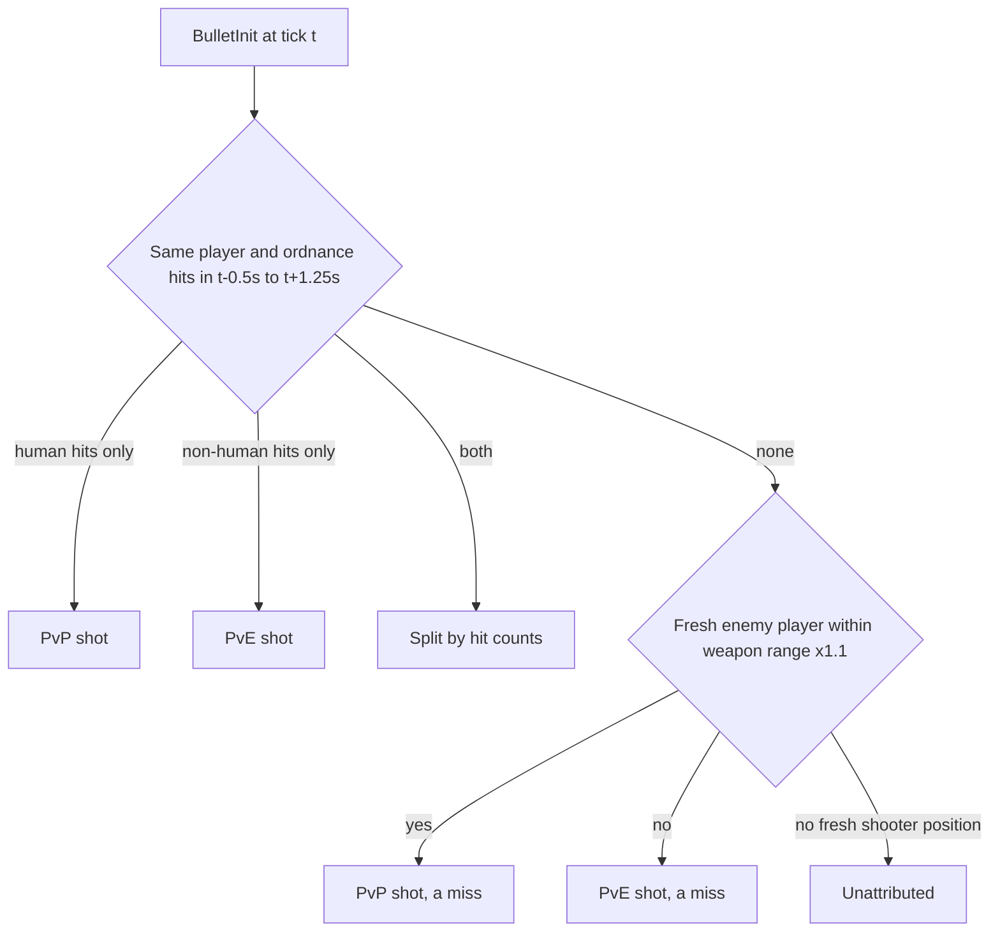

# Wire BulletHit: exact accuracy, hit mix, experimental PvP/PvE accuracy

## What changed upstream (verified)

- Only one behavioural change shipped. In `statsgate/src/stat_client.cpp` `record_bullet_hit`, the guard `if (!shooter || !victim) return;` became `if (!shooter) return;`. `victim` (Steam64) is still set only for human victims, and `victim_odf` is always set.
- The proto gained `Quat`, `RecorderType recorder_type = 23`, `PlayerState.orientation = 9`, `AIState` and `MagnetForce magnet_force = 10`. **None of these are populated yet**: the magnet callback is commented out, and nothing sets the orientation or the recorder type. All of it is additive, so no freeze is needed.
- Corpus: 9 wire matches so far, all already classified `event_calibration.hits_est_source = "wire"`.

## Measurements that shape the design (9 wire matches)

- **Volume:** non-human hits are 70-80% of all BulletHits, mostly AI vehicles and buildings.
- **Victim team:** the BulletHit-to-DamageDealt join on `(tick, shooter, ordnance)` resolves victim team for almost every hit: 97-99% enemy, 0.2-5% friendly, under 1% neutral.
- **No inflation:** hits never exceed shots for any weapon.
- **Reconstruction:** the schema-32 damage-event reconstruction recovers 98.8% of the wire's non-human hits. The missing hits are no-damage weapons: `tracer`, `leadervsr_c`, `epulse`, `fsnip_c`.
- **Per-shot window labels:** about 30% of shots are PvP, 54% PvE, 6% mixed and 9% have no nearby hit.
- **Enemy player in range** (weapon range x1.1), by label: PvP-labelled shots 99%, PvE-labelled 31%, no-nearby-hit shots 76%. So most shots with no hit are misses at players, and proximity is the right fallback for them.

## 1. Proto mirror

- Copy [statsgate/statsgate.proto](statsgate/statsgate.proto) verbatim over [scripts/statsgate.proto](scripts/statsgate.proto).
- Regenerate `scripts/statsgate_pb2.py` (`python -m grpc_tools.protoc --proto_path=scripts --python_out=scripts statsgate.proto`).
- Regenerate `vendor/protobufjs/statsgate.proto.json` (through `cmd /c` so the output is not UTF-16).
- [js/raw-browser.js](js/raw-browser.js):
  - Add `PROTO_TYPE_MAP` entries `eventStream.*.magnetForce` (`MagnetForce`) and `eventStream.*.updateTick.players.*.orientation` (`Quat`).
  - Add a `magnetForce` entry to `EVENT_ARM_LABELS`, and add `magnetForce` to `EVENT_ARMS_ALL`. It joins the chip set only when the decoded stream actually contains one.
- No `v5` stamp. Presence detection is deferred until the new fields are populated.
- Run `scripts/verify_proto_decode.mjs` on one file per era.

## 2. Pipeline ([scripts/process_stats.py](scripts/process_stats.py))

Bump `PIPELINE_VERSION` 56 to 57 and `match.schema_version` 32 to 33. `ELO_SCHEMA_VERSION` stays unchanged, because none of this is a rating input.

**a. Exact hit mix.** Wire matches only; the field is absent on other matches.
- New helper `_index_nonhuman_victim_teams(events)`: one deque of `victim_team` per `(tick, shooter, ordnance_lower)` key. It holds only DamageDealt events with `victim == 0`, so PvP events cannot interleave.
- New `_load_vehicle_odfs(odf_db)`, mirroring `_load_building_odfs`.
- In the `bullet_hit` branch, each non-human hit pops its team and is classed enemy, friendly, neutral or unresolved. Unresolved means no damage event, as with TAG hits.
- Target type: `building_odfs`, then the vehicle set, else `other`.
- Emits `personal.hit_mix = {pvp, self, pve_enemy, pve_friendly, pve_neutral, pve_unresolved, pve_by_target: {vehicle, building, other}}`.
- Partition: the six counts sum to `shots_hit`.

**b. Experimental context accuracy.** Wire matches only. The proximity check needs fresh positions, so add a `last_known_pos_tick` sibling dict next to `last_known_pos`. Do not change the tuple shape the distance guard reads. Each shot is labelled like this:

- **Recording:** the `bullet_init` branch logs `(tick, s64, ordnance, enemy_in_range)`. `enemy_in_range` uses `_resolve_max_range`, with a 200 m fallback.
- **Labelling:** the pure function `_attribute_shot_context(...)` labels the shots after the loop, using bisect over sorted hit ticks.
- **Tunable constants:** `CTX_ACC_PRE_SEC` 0.5, `CTX_ACC_POST_SEC` 1.25, `CTX_ACC_RANGE_FACTOR` 1.1, `CTX_ACC_FALLBACK_RANGE_M` 200, `CTX_ACC_POS_MAX_AGE_SEC` 2.0, `CTX_ACC_MIN_SHOTS` 20.
- **Per-player output:** `personal.context_accuracy = {pvp_shots, pve_shots, unattributed_shots, pvp_hits, pve_hits, pvp, pve, fallback_shots, mixed_shots}`.
  - Hits stay exact: `pvp_hits = pvp_shots_hit` and `pve_hits = shots_hit - pvp - self`.
  - The `pvp` / `pve` ratios are null below the minimum-shots threshold and clamped to at most 1.
  - Partition: the three shot buckets sum to `shots_fired`.
- **Match-level output:** `match.shot_attribution = {method_version: 1, constants, label_shares}`, or null when the match has no wire hits.

**c. Honest flags.** The Sharpshooter and Gunner `estimated` flag (around line 1282 and line 1307) becomes `hits_est_source != "wire"`.

**d. Contribution slice.** `_extract_contribution` adds `hits_est_source` on the entry, and `hit_mix` plus `context_accuracy` on each row.

## 3. Aggregator ([js/all-matches-aggregator.js](js/all-matches-aggregator.js))

- Per player and in `meta`: `matches_with_wire_hits`, summed `career_hit_mix`, and the four context sums, with a `matches_with_context_accuracy` denominator.
- Derived `career_pvp_ctx_accuracy` / `career_pve_ctx_accuracy`, using `r3`.
- Picker-scoped like the rest of the aggregate.

## 4. Frontend

**Labels ([js/app.js](js/app.js)):**
- `accOf()` and the per-weapon, faction (around line 6693) and [js/charts.js](js/charts.js) (around line 662) sites drop `~` / `(est.)` when `hits_est_source === 'wire'`. They use a new `ACC_WIRE_TITLE` saying the count is exact.
- The Hits column in `renderAccuracyTable` shows `shots_hit_est`, so it agrees with the Accuracy column on reconstructed matches.
- The "PvP Acc" columns in the weapon breakdown (around lines 6464-6491) and the per-ship table (around line 6427) are relabelled **PvP share**. Tooltip: "share of all shots that landed on a player".
- The per-ship Acc tooltip notes that before 2026-10-18 it counted human hits only.
- [js/elo.js](js/elo.js) (around lines 854-857) shows the career tilde only while some match in scope is not wire.

**New columns:**
- `#accuracy-table` in [index.html](index.html) gains **Hit mix**: a stacked mini-bar of PvP, enemy units, enemy buildings and friendly/neutral/other, styled by `.vt-hitmix-bar` in [css/vtstats-theme.css](css/vtstats-theme.css) with `--kb-*` colours.
- It also gains **PvP acc** and **PvE acc**, each with an `exp.` badge and a method tooltip. These show an em-dash on non-wire matches.
- `#career-accuracy-table` gains the two career context columns, with their match count shown in the tooltips.
- No "coming soon" copy anywhere.

## 5. Gates (local, in `_investigation/`)

- **`check_accuracy_recon.py`:**
  - On every wire session, compare `_estimate_weapon_hits` against wire non-human hits.
  - Pass when corpus recovery is between 0.95 and 1.02 and the per-player p95 accuracy difference is at most 3 percentage points.
  - Print the per-weapon table.
  - Append a dated, results-only "Wire cross-check" note to [critique/decisions/accuracy-recon-axis.md](critique/decisions/accuracy-recon-axis.md), with no rule change.
- **`check_context_accuracy.py`:**
  - Fixture tests of `_attribute_shot_context`: pure PvP, pure PvE, mixed, empty with an enemy in range, empty without one, and a stale position.
  - Corpus invariants over processed JSON: the `hit_mix` partition, the shot partition, and ratios between 0 and 1.
- **`golden_accuracy_v33_inert.py`:** strip and perturb `hit_mix`, `context_accuracy` and `shot_attribution`, then require byte-identical VTSR-T and VTSR-C. Also hash `elo_history.json` before and after the reprocess.

## 6. Docs

- [.cursor/rules/data-schema.mdc](.cursor/rules/data-schema.mdc):
  - Rewrite the BulletHit Source-Level Filters bullet and the event table row.
  - Add the proto additions (declared, not emitted).
  - Add a schema-33 section.
- [.cursor/rules/filter-contract.mdc](.cursor/rules/filter-contract.mdc): rows for the new fields. Per-player fields narrow with leaderboard rows; `shot_attribution` passes through as match-global.
- `DEVELOPER_GUIDE.md` sections 2, 3 and 5, and `docs/DATA_DICTIONARY.md`.
- A short note in `project-overview.mdc`.

## 7. Upstream request (delivered in chat, no repo file)

A ready-to-paste issue for VTrider/statsgate:
- Record the ordnance position and direction in `BulletInit`. The callback already receives `ordnanceMat` and `ordnanceVel`.
- Optionally record the fire-time `GetUserTarget` in `BulletInit`.
- Add `victim_team` to `BulletHit`.
- Add a shared ordnance id between `BulletInit` and `BulletHit`.
- Populate `orientation` and `recorder_type`.
- Fix the stale "Either shooter or victim" comment.
- Note that hits are dropped when the shooter has ejected before impact.

## Verification

- Reprocess with `python scripts/process_stats.py --no-prompt`.
- Run the three gates.
- Confirm `elo_history.json` is unchanged.
- Browser-check:
  - a wire match: no tilde, and Hit mix and the experimental columns render;
  - a 2026-10-17 match: tilde kept, experimental columns show em-dashes;
  - All Matches career accuracy;
  - a raw-browser decode.