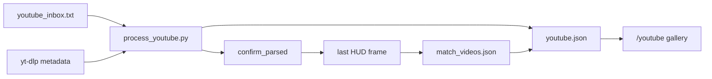

# YouTube gallery — baseline

The product brief is [youtube_video_gallery_356bd7e2.plan.md](youtube_video_gallery_356bd7e2.plan.md). It is still accurate about what to build. This file is the implementation plan: what the repo actually contains, what that brief got wrong relative to the code, and the order to build it. Do not start `scripts/process_stats.py`.

## What is already true

Checked against the tree on 2026-11-17. None of the gallery files exist. No `youtube/`, no `scripts/process_youtube.py`, no `data/external/youtube.json`, no `youtube_inbox.txt`, no `youtube_aliases.json`.

The VOD library the brief wants to call is in place:

- [scripts/process_extvids.py](../../scripts/process_extvids.py) has `parse_f9_title`, `parse_record_date`, `shortlist`, `last_hud`, `confirm_candidates`, `map_pair`, `shortlist_ledger`, and the ledger fallback inside `consider_video`. There is no `confirm_parsed`.
- [scripts/map_match_video.py](../../scripts/map_match_video.py) is still the only store writer. Duration tolerance is 20 seconds (telemetry) and 30 seconds (ledger). Tail scan is 15 second steps.
- [data/external/video_channels.json](../../data/external/video_channels.json) has one row: F9bomber, parser `f9`, POV `F9bomber`.
- [data/external/match_videos.json](../../data/external/match_videos.json) earliest key is still `2026-05-11T03-51-55`. The floor constant stays `date(2026, 5, 11)`.
- `PLAYER_TEMPLATE_VERSION` is 33. `MAP_TEMPLATE_VERSION` is 23. The bumps in the brief (34 and 24) are still the next versions.
- Tools order on every production shell is Live Lobby, Game Watch, Discord Time, Discord Invite, Record Stats, Beta Versions, Port Forwarding. YouTube inserts immediately after Discord Time, copying that line's relative prefix (`youtube/` at the site root, `../youtube/` everywhere else).
- [odf/guide/index.html](../../odf/guide/index.html) still has no Tools menu. Leave it.
- `/_investigation/` is gitignored, and that directory is not in this checkout. A gate written only there would not travel with the repo.

The seed [tmp/youtube_video_list.txt](../../tmp/youtube_video_list.txt) is present (102 CSV rows, no header). Leave it. Copy it to `data/external/youtube_inbox.txt` on the first pass. Channels in the file: `@bz2aggressor` (44), `@F9bomber` (30), `@bz2vsr` (18), `@DraconisMarchVII` (7), `@herpmcderperson` (3). Most Aggressor rows have `Unknown` for faction, map, and often the date. `Unknown` and blanks are null. They are not filter chips and they are not a recording date.

## Corrections to the brief

**1. One extractor per channel, not `parse_f9` for the whole inbox.** `parse_f9_title` returns nothing unless the title contains `vsr` and a `|` map segment that is not the `vs` segment. `consider_video` then drops the video before it fetches the description (`parser(title, "") is None` → `skip-title`). That gate stays on the F9 channel listing. The inbox script always fetches title and description, then selects an extractor by inbox handle. Sampled titles (2026-11-18): F9 uses the existing title parser plus `Recording date:` in the description. `@bz2vsr` is `Name (Faction) vs Name (Faction) - Map YYYYMMDD`. Herp puts factions in parentheses and an English date at the end, with the map between them. DraconisMarch puts `Name (Faction) vs. Name (Faction)` between a note and a format (`3v3`), so the map is not in the title. Aggressor titles are `Name vs Name` only. A parsed field wins over the CSV. The CSV fills whatever that channel's extractor left empty. YouTube's upload date is never the play date. Before the HUD pass, print rows whose extracted commanders or date disagree with the CSV. A non-empty disagreement list stops the HUD downloads until that list has been reviewed.

**2. POV rows must not become a channel listing.** `process_extvids.py` lists every channel in `video_channels.json`. Adding Aggressor, Herp, DraconisMarch, and `@bz2vsr` as normal rows would make the next channel-scan walk their upload history. Add the five posters with `"scan": false`. `run()` skips those rows. The inbox script still reads `pov` from them. POV names: F9bomber, Aggressor, Herp McDerperson, DraconisMarch. `@bz2vsr` keeps an empty POV so the roster check is skipped. `consider_video` and the F9 title gate stay as they are. Do not delete `process_extvids.py`.

**3. The catalog gate is a committed script.** `scripts/check_youtube_catalog.py`, not `_investigation/check_youtube_catalog.py`. Raw yt-dlp JSON still caches under gitignored `_investigation/output/youtube/`.

**4. The coding pass includes one full HUD confirmation of the seed.** Decided 2026-11-17. Metadata for the 102 URLs is a short `yt-dlp` run. Each new, unmapped video that has a commander pair and a recording date then goes through `confirm_parsed` (download the ending, OCR the last HUD, write `match_videos.json` only on a single survivor). That is on the order of a couple of minutes per attempted video, and a later run only retries videos still unmapped. Needs `yt-dlp` plus the mapper deps (`opencv-python`, `easyocr`, `numpy`, `ffmpeg` or `imageio-ffmpeg`). `--self-test` still covers the parsers with no network and runs before the long pass. `--dry-run` prints the pair and does not call the mapper. `--limit` caps confirmations. `--skip-map` writes the gallery file only, and is the fallback if the OCR deps are missing — in that case the page still ships and the match pass is reported as not run. Videos with no recording date, an incomplete commander pair, or a map-less shortlist longer than 8 are not downloaded.

Everything else in the brief stands: inbox only (no channel scrape), date window is the recording date or the next UTC day, no match link unless `map_match_video.py --yes` wrote the video into `match_videos.json`, no copied OCR or store writer, exact normalized names only, new typos live in `youtube_aliases.json` and not in the F9 ledger files, stub regen does not recompute `map_stats.json`, no `PIPELINE_VERSION` / `match.schema_version` / Elo schema bump. Forbidden readers: `scripts/process_stats.py`, `scripts/elo.py`, `scripts/elo_commander.py`, `js/all-matches-aggregator.js`.

## Library change

In [scripts/process_extvids.py](../../scripts/process_extvids.py), pull the post-parse half of `consider_video` into `confirm_parsed(parsed, video, channel, manifest, aliases, known_ids, gpu, dry_run, ledger...)`. `consider_video` parses, then calls it. The function:

- Applies `VOD_MATCH_FLOOR` before the shortlist. A match dated before 2026-05-11 is ignored.
- Uses the existing `shortlist` when `map_title` is set (commanders, map, recording date, POV).
- When `map_title` is empty, shortlists on commanders + recording date + POV only, and skips the download when that list is longer than 8 (`too-wide`).
- A missing commander pair or a missing recording date returns `no-date` / `incomplete` and does not download. The upload date is not a substitute.
- Then the same `last_hud` → `confirm_candidates` → `map_pair` path. Zero or several survivors stay unlinked. The reason goes in the gitignored report.
- An empty telemetry shortlist still tries the existing F9 ledger fallback (30 second clock). One hit writes `f9_video_links.json` only. Those cards get no match link.

`shortlist()` itself keeps requiring a map, so the channel scanner's current matches do not widen.

## Inbox script

[scripts/process_youtube.py](../../scripts/process_youtube.py). Not imported by the pipeline.

- Keyed by video id. A second copy of the same URL updates hints only.
- New ids: `yt-dlp --skip-download` for title, description (capped for search), channel name and URL, upload date, duration. Cache the raw JSON.
- Already-stored ids are left alone unless the hint line changed or `--refresh` is passed. A video already in `match_videos.json` or `f9_video_links.json` is not OCR'd again.
- Names resolve by exact normalized spelling against `data/steamid_to_name.txt`, then `data/external/f9_name_map.json`, then `data/external/youtube_aliases.json`. No substring match. Known messy seed spellings to look up while writing the alias file: `normad`, `Dom`, `CBG`, `Draconic`, `Tsahaliswas`, `rectal`, `Aussault`, `ancient hills`, `fort12c`. If one does not resolve, leave it out.
- Maps resolve through `f9_map_aliases.json` and `data/map-registry.json`. A miss stays text with no map link.
- Writes `data/external/youtube.json` (`schema_version: 1`, newest upload first). Each row: `video_id`, `url`, `channel`, `title`, `description`, `upload_date`, `duration_sec`, `recording_date`, `commanders[]` (`name`, `steam64`, `slug`, `faction`), `map` (`raw`, `title`, `slug`), `match` (`id` only, and only after that video id is in `match_videos.json`). Sort is upload date, then the recording-date hint. Faction on the card is ISDF, Hadean, or Scion from the hint until a linked match replaces it with `team_factions`.

`--self-test` fixtures cover: description beats title, title fills a blank description field, CSV hint fills the rest, `Unknown` becomes null, a map-less shortlist over 8 is `too-wide`, a date before the floor is ignored, and the upload date is not used as the play date.

## Page

[youtube/index.html](../../youtube/index.html), [js/youtube.js](../../js/youtube.js), [css/youtube.css](../../css/youtube.css). Copy the shell from [discord/index.html](../../discord/index.html): vendored Bootstrap, the theme CSS load order, canonical topnav. No new inline `<style>`. Colors from `var(--kb-*)` only.

Gallery, newest first:

- Thumbnail `https://i.ytimg.com/vi/<id>/hqdefault.jpg` (hotlink). The card opens the video in a new tab. No embedded player.
- Channel name links to the channel `yt-dlp` returned. Commander links use `player_slugs.json`. Map links use the registry key. Faction badges use `.vt-faction-badge`.
- **Watch on this match** links to `matches/?match=<id>` only when `match.id` is set.
- Client-side filters, mirrored in the URL: text (title, description, commanders, map), channel, commander, faction, map, linked / not linked. Facets come from the rows that exist.
- 404-safe empty state. Corpus-wide, picker-unaware, not in the pipeline cache key.

Hand-edit the Tools item on: `index.html`, `matches/index.html`, `player/index.html`, `map/index.html`, `models/index.html`, `lego/index.html`, `lego/studio/index.html`, `explorer/index.html`, `odf/index.html`, `build/index.html`, `weapons/index.html`, `elo/index.html`, `meta/index.html`, `tools/index.html`, `gw/index.html`, `time/index.html`, `discord/index.html`, `record/index.html`, `beta/index.html`, `ports/index.html`, `raw/index.html`, `docs/index.html`, `scripts/player_template.html`, `scripts/map_template.html`.

```html
<li><a class="dropdown-item" href="youtube/"><i class="bi bi-youtube me-2"></i>YouTube</a></li>
```

No home-page door. The how-to grid is unchanged.

Bump `PLAYER_TEMPLATE_VERSION` 33 → 34 and `MAP_TEMPLATE_VERSION` 23 → 24, including the version comment above each constant. Re-render stubs only:

- Players: `generate_player_pages.run(elo_current=<existing elo_current.json>, output_dir=data/processed, project_root=repo)`.
- Maps: `_render_map_stubs` with the existing `data/processed/map_stats.json` and `data/map-registry.json`. Do not call `generate_map_pages.run` with an empty match list.

## Docs

- [DEVELOPER_GUIDE.md](../../DEVELOPER_GUIDE.md) §19.4. The operator command for this catalog is `python scripts/process_youtube.py`. §19.2's queue command (`process_match_videos.py`) and the channel scanner stay documented as they are.
- A store entry beside §16 in [docs/DATA_DICTIONARY.md](../../docs/DATA_DICTIONARY.md).
- Tools list in [project-overview.mdc](../rules/project-overview.mdc) and [styling.mdc](../rules/styling.mdc).
- One filter-contract row: `youtube.json` is display-only external data, same posture as `match_videos.json`. The page filter is not the per-match `filterState`.

## Check

`python scripts/process_youtube.py --self-test` and `python scripts/check_youtube_catalog.py` (unique ids, no stored `"Unknown"`, every `match.id` exists in both JSON files, forbidden readers do not open `youtube.json`).

Serve with `python scripts/dev_server.py`. Open `http://localhost:8000/youtube/` and use it: search, channel filter, a card opens YouTube in a new tab, a linked card opens the match, an unlinked card has no match control. Confirm the Tools item on one other shell, and confirm the ODF Guide nav is unchanged.


