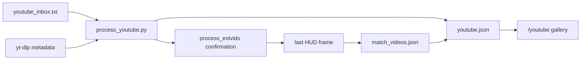

# YouTube gallery

Implementation has not started. This file is the whole brief. The repo already contains the VOD timestamp machinery; this work adds a gallery and one operator script in front of it.

## Cold start

This file is `.cursor/plans/youtube_video_gallery_356bd7e2.plan.md` in the repo. Read it before writing code. The seed list committed beside it is [tmp/youtube_video_list.txt](tmp/youtube_video_list.txt) (about 100 CSV rows). That path is not gitignored. Do not delete it. On the first implementation pass, copy it to `data/external/youtube_inbox.txt` and leave the tmp original in place. After that, new links are appended to `data/external/youtube_inbox.txt`. The tmp file is the snapshot that traveled with the commit.

On the other PC: clone the repo, confirm `tmp/youtube_video_list.txt` is present, read `.cursor/rules/` and this plan, then implement. Python 3. Metadata needs `pip install yt-dlp`. Matching also needs `pip install opencv-python easyocr numpy imageio-ffmpeg`. Serve with `python scripts/dev_server.py` and open `http://localhost:8000/youtube/`. Do not start by running `scripts/process_stats.py`.

Repo conventions that bind this work (also in `.cursor/rules/`): static site, no CDN scripts, pipeline owns match aggregation, do not bump `PIPELINE_VERSION` / `match.schema_version` / any Elo schema. `youtube.json` is display-only external data, same posture as `match_videos.json`. Forbidden readers: `scripts/process_stats.py`, `scripts/elo.py`, `scripts/elo_commander.py`, `js/all-matches-aggregator.js`. Colors from `var(--kb-*)` only. No inline `<style>`. Page shell and CSS load order: copy [discord/index.html](discord/index.html).

### Do not

- Do not list a channel's upload history. The catalog is only the inbox file.
- Do not walk every historical match. Each video is compared only to matches on its recording date or the next UTC day, and never to a match before `2026-05-11` (earliest saved VOD: `2026-05-11T03-51-55`).
- Do not treat the YouTube upload date as the day the game was played.
- Do not write a match link because commanders and a map merely line up. The only writer is the existing HUD test, then `map_match_video.py --yes`.
- Do not copy the OCR or the store writer out of [scripts/process_extvids.py](scripts/process_extvids.py) and [scripts/map_match_video.py](scripts/map_match_video.py). Add `confirm_parsed` there and call it.
- Do not delete `process_extvids.py`. It stays the library. The runbook's operator command becomes `python scripts/process_youtube.py`.
- Do not substring-match player or map names. Exact normalized spelling only.
- Do not put this list's typos into [data/external/f9_name_map.json](data/external/f9_name_map.json) or [data/external/f9_map_aliases.json](data/external/f9_map_aliases.json). Those files feed the ledger. New aliases go in `data/external/youtube_aliases.json`.
- Do not run `scripts/process_stats.py` to refresh nav. Do not call `generate_map_pages.run` with an empty match list: that recomputes `map_stats.json` from nothing.

### Files

Create:

- `data/external/youtube_inbox.txt` — copy of the committed seed [tmp/youtube_video_list.txt](tmp/youtube_video_list.txt). Leave the tmp file in the repo. The inbox is the file the operator appends to afterward.
- `data/external/youtube_aliases.json` — `{schema_version, names, maps}`. `names` maps a normalized spelling to a Steam64 that already exists in [data/steamid_to_name.txt](data/steamid_to_name.txt). `maps` maps a normalized title to a [data/map-registry.json](data/map-registry.json) key. Known messy spellings in the seed: `normad`, `Dom`, `CBG`, `Draconic`, `Tsahaliswas`, `rectal`, `Aussault`, `ancient hills`, `fort12c`. Look them up. If one does not resolve, leave it out.
- `data/external/youtube.json` — written by the script, read by the page.
- `scripts/process_youtube.py`
- `_investigation/check_youtube_catalog.py`
- `youtube/index.html`, `js/youtube.js`, `css/youtube.css`

Edit:

- [scripts/process_extvids.py](scripts/process_extvids.py) — extract `confirm_parsed` from the post-parse half of `consider_video` (`shortlist`, `last_hud`, `confirm_candidates`, `map_pair`, and the ledger fallback `_finish_ledger`). `consider_video` calls it. Add a map-less shortlist used only when `map_title` is empty: commanders + recording date + POV, cap 8 candidates, then the same clock and scoreboard test. Constant `VOD_MATCH_FLOOR = date(2026, 5, 11)` applied before the shortlist.
- [data/external/video_channels.json](data/external/video_channels.json) — add the five posters. POV is the in-game name required on the roster: F9bomber, Aggressor (`@bz2aggressor`), Herp McDerperson (`@herpmcderperson`), DraconisMarch (`@DraconisMarchVII`). `@bz2vsr` posts other people's games, so its POV is empty and the roster check is skipped.
- Every production shell that already has a Discord Time item, plus both templates. Not the generated stubs, and not [odf/guide/index.html](odf/guide/index.html) (its nav deliberately omits Tools).
- Docs listed at the bottom.

Hand-edit the Tools menu on: `index.html`, `matches/index.html`, `player/index.html`, `map/index.html`, `models/index.html`, `lego/index.html`, `lego/studio/index.html`, `explorer/index.html`, `odf/index.html`, `build/index.html`, `weapons/index.html`, `elo/index.html`, `meta/index.html`, `tools/index.html`, `gw/index.html`, `time/index.html`, `discord/index.html`, `record/index.html`, `beta/index.html`, `ports/index.html`, `raw/index.html`, `docs/index.html`, `scripts/player_template.html`, `scripts/map_template.html`. Insert immediately after Discord Time, copying that line's relative prefix:

```html
<li><a class="dropdown-item" href="youtube/"><i class="bi bi-youtube me-2"></i>YouTube</a></li>
```

Stubs under `player/<slug>/` and `map/<slug>/` are generated. Bump `PLAYER_TEMPLATE_VERSION` 33 → 34 in [scripts/generate_player_pages.py](scripts/generate_player_pages.py) and `MAP_TEMPLATE_VERSION` 23 → 24 in [scripts/generate_map_pages.py](scripts/generate_map_pages.py), including the version comment above each constant. Then re-render stubs only:

- Players: `generate_player_pages.run(elo_current=<existing elo_current.json>, output_dir=data/processed, project_root=repo)`.
- Maps: call `_render_map_stubs` with the existing `data/processed/map_stats.json` and `data/map-registry.json`. Do not recompute map stats.

### Reuse, do not rewrite

[scripts/process_extvids.py](scripts/process_extvids.py) already has `parse_f9_title`, `parse_record_date` (`Recording date: M.D.YY`), `shortlist`, `last_hud`, `confirm_candidates`, `map_pair`, `shortlist_ledger`, `confirm_ledger`. [scripts/map_match_video.py](scripts/map_match_video.py) has `identity_gate`, `roster_names`, `youtube_watch_url`. Duration tolerance is 20 seconds for a telemetry match and 30 seconds for a ledger row. Tail scan is 15 second steps, at most a few minutes of credits.

The gallery match link is `matches/?match=<id>` and only appears after that video id is in [data/external/match_videos.json](data/external/match_videos.json). Kill feed, storyline, and the replay Watch button already read that file through [js/video-links.js](js/video-links.js). A ledger-only hit writes [data/external/f9_video_links.json](data/external/f9_video_links.json) and gets no match link.

Player profile links use [data/processed/player_slugs.json](data/processed/player_slugs.json). Map links use the registry key. Faction badges use the existing `.vt-faction-badge` styles. Thumbnails are `https://i.ytimg.com/vi/<id>/hqdefault.jpg` (a hotlink, not a vendored asset). No embedded player.

### Operator command

```
python scripts/process_youtube.py
python scripts/process_youtube.py --dry-run --limit 3
python scripts/process_youtube.py --skip-map
python scripts/process_youtube.py --self-test
python _investigation/check_youtube_catalog.py
```

Needs `yt-dlp` for metadata. A mapping pass also needs the deps already documented for `map_match_video.py`: `opencv-python`, `easyocr`, `numpy`, and `ffmpeg` (or `imageio-ffmpeg`). The seed is about a hundred URLs. Metadata is minutes. Each HUD confirmation is on the order of a couple of minutes, and a later run only retries videos still unmapped. Cache raw yt-dlp JSON under gitignored `_investigation/output/youtube/`.

If OCR deps are missing, still ship the gallery via `--skip-map` and say the match pass was not run.

### Check the page

Serve the site the way the repo already does, open `/youtube/`, and use it: search, channel filter, a card opens YouTube in a new tab, a linked card opens the match, an unlinked card has no match control. Check one other shell to confirm the Tools item is present, and the ODF Guide to confirm it was left unchanged.

YouTube has no unauthenticated channel API the browser can call, and a full channel scrape would pull years of non-match uploads. The catalog stays the list you append to. `yt-dlp` (already the operator tool behind [scripts/map_match_video.py](scripts/map_match_video.py)) fills in title, description, channel, upload date, and duration for each new URL. The page never calls YouTube.

One manual run replaces a separate `process_extvids.py` invocation. [scripts/process_youtube.py](scripts/process_youtube.py) owns the inbox. Match mapping stays the code already in [scripts/process_extvids.py](scripts/process_extvids.py): the same shortlist, the same last-frame HUD test, and the same `map_match_video.py --yes` write into [data/external/match_videos.json](data/external/match_videos.json). The gallery script does not copy the OCR or the store writer. `process_extvids.py` stays in the tree as that library (and its old whole-channel scan); the runbook tells you to run the inbox script.



## What posters should write

Three fields identify the game. The on-screen Mission Time separates two games that share all three, so posters do not write a duration or a start time.

The same two lines may sit in the title, in the description, or split across them. Description alone is enough, which is what a joke title needs. The inbox script always fetches both fields, so a title is never required.

- `CommanderA vs CommanderB | Map Name`. Both names are the team leaders, spelled the way VT Stats shows them. The map is the name from the map list. Order of the two commanders does not matter.
- `Recording date: M.D.YY` (the calendar day they played, US month/day). The YouTube upload date is not a substitute.

When both fields contain a line, the description wins and the title only fills a field the description left empty. Inbox hints fill whatever is still empty after that.

Factions, the rest of the roster, and a match length are not required to find the match. Factions still help the gallery filter when a video never links.

## Inbox

Copy the committed seed [tmp/youtube_video_list.txt](tmp/youtube_video_list.txt) to [data/external/youtube_inbox.txt](data/external/youtube_inbox.txt) and keep the tmp file. Append new lines at the bottom of the inbox. Blank lines and `#` comments are ignored. Two line shapes:

- A bare URL, which is enough once the script can read the title and the description.
- The current row, kept so the grokbot pass is not thrown away: `channel, commander1, faction1, commander2, faction2, map, YYYYMMDD, url`.

`Unknown` and blanks are not data. They become null and never appear as a filter chip.

Adjustments to that row:

- Channel handle is only a hint. The card credits the channel name and URL `yt-dlp` returns.
- Commander and map spellings are hints that fill gaps. The description is parsed first, then the title fills any field still empty (F9’s `A vs B | … | map` rule, same as `parse_f9` in [scripts/process_extvids.py](scripts/process_extvids.py), plus a generic `A vs B` fallback, and `Recording date:` in either field).
- Faction is kept only for ISDF, Hadean, or Scion. When a match is linked, the match’s `team_factions` replace the hint.
- `YYYYMMDD` is the recording date. Sort order is YouTube upload date, then this date.
- Names resolve by exact normalized spelling against [data/steamid_to_name.txt](data/steamid_to_name.txt), then [data/external/f9_name_map.json](data/external/f9_name_map.json), then a small new [data/external/youtube_aliases.json](data/external/youtube_aliases.json) for this list’s typos (`normad`, `Dom`, `CBG`, `Draconic`). No substring match, so `Dom` cannot silently become someone else. A resolved name links to `/player/<slug>/` via [data/processed/player_slugs.json](data/processed/player_slugs.json).
- Map titles resolve through [data/external/f9_map_aliases.json](data/external/f9_map_aliases.json) and [data/map-registry.json](data/map-registry.json). A hit links to `/map/<slug>/`. A miss stays searchable text with no map link. New junk aliases stay in `youtube_aliases.json`, not in the F9 ledger file.

## Script

[scripts/process_youtube.py](scripts/process_youtube.py), not part of the pipeline and not imported by `process_stats.py`, `elo.py`, or `elo_commander.py`.

- Keyed by video id. A second copy of the same URL updates hints only.
- New ids: `yt-dlp --skip-download` JSON (title, description capped for search, channel, upload date, duration). Raw responses cached under gitignored `_investigation/output/youtube/` so a rerun does not re-fetch.
- Already-stored ids are left alone unless the hint line changed or `--refresh` is passed. A video already in `match_videos.json` or [data/external/f9_video_links.json](data/external/f9_video_links.json) is not OCR'd again.
- Writes [data/external/youtube.json](data/external/youtube.json) (`schema_version: 1`, videos newest-upload first). Each row: `video_id`, `url`, `channel`, `title`, `description`, `upload_date`, `duration_sec`, `recording_date`, `commanders[]` (`name`, `steam64`, `slug`, `faction`), `map` (`raw`, `title`, `slug`), `match` (`id` only, and only after the HUD test has written that video into `match_videos.json`).

## Match attempt

The script never lists a channel's history and never walks the old match archive. The only videos it fetches or tests are the rows in the inbox. Most matches before the first saved VOD have no recording, so a match dated before `2026-05-11` (the earliest id in `match_videos.json`, `2026-05-11T03-51-55`) is ignored. That floor is a constant in the script.

Each video is then compared only to matches on its own recording date or the next UTC day, which is the window the inbox dates already imply. A video from the current list (mid-October onward) never looks at a May game.

After that date cut, every new video that is not already mapped is handed to the existing confirmation. A small refactor pulls the post-parse half of `consider_video` into something both scripts call (`confirm_parsed`): shortlist, `last_hud`, `confirm_candidates`, then `map_pair`. The inbox script builds the `{commanders, map_title, record_date}` dict from the title parser plus inbox hints, then calls that. Nothing is written because two commanders and a map happened to line up. The write happens only when the test already used by `process_extvids.py` passes:

- Both names are the match’s two `team_leaders` (either order). The map title matches the manifest name or [data/external/f9_map_aliases.json](data/external/f9_map_aliases.json). The match’s UTC date is the recording date or the next day. The channel POV, when one is set, is on the roster.
- The script seeks backward from the end of the video until Mission Time OCRs (15s steps, at most a few minutes of credits). That clock must be within 20 seconds of the match’s `duration_sec`, and `identity_gate` must pass on that same frame.
- Exactly one match survives. `map_match_video.py --yes` then writes the timestamp segments. Zero or several survivors stay unlinked, with the reason in the gitignored report, and the next run retries them.

A missing map still gets an attempt. The shortlist drops the map requirement and keeps commanders, date, and POV, then the same clock and scoreboard test decide. A shortlist longer than 8 skips the download and is reported as too wide, so a map-less title cannot OCR the whole corpus. A missing commander pair or a missing recording date is not attempted (`no-date` / `incomplete`). YouTube’s upload date is not used as the play date.

When the telemetry shortlist is empty, the same call tries the existing F9 ledger fallback (non-overlap duels, clock within 30s, scoreboard on the sheet names). One hit writes `f9_video_links.json` only. Those games have no tick stream, so the gallery card does not grow a match link.

Channel POV lives in [data/external/video_channels.json](data/external/video_channels.json), which gains the five posters: F9bomber, Aggressor, Herp McDerperson, DraconisMarch. `@bz2vsr` posts other people’s games, so its POV stays empty and the roster check is skipped. A wrong POV is the usual reason a real game is refused; clearing that channel’s POV is the fix.

Flags: `--dry-run` prints the pair and does not call the mapper; `--limit N` caps how many videos are confirmed this run; `--skip-map` writes the gallery file only. Each confirmation downloads the ending and, on a hit, OCRs the VOD for the timestamp map (on the order of a couple of minutes per video). The seeded inbox is about a hundred URLs, so the first full run is long. Metadata is cached; a rerun only confirms videos still unmapped.

`--self-test` covers the parsers and the map-less shortlist with no network. A small gate `_investigation/check_youtube_catalog.py` checks unique ids, no stored `"Unknown"`, every linked match id exists in both `youtube.json` and `match_videos.json`, and the forbidden readers do not open `youtube.json`.

First implementation run processes the seeded inbox. It needs `yt-dlp`, and a mapping pass also needs the operator OCR deps already documented for `map_match_video.py` (`opencv-python`, `easyocr`, `numpy`, `ffmpeg`).

## Page

[youtube/index.html](youtube/index.html), [js/youtube.js](js/youtube.js), [css/youtube.css](css/youtube.css). Same shell as [discord/index.html](discord/index.html): vendored Bootstrap, theme CSS, canonical topnav. The Tools item and the stub regen are specified under Cold start. The ODF Guide keeps its shorter nav.

Gallery, newest first:

- Thumbnail from `i.ytimg.com` (a hotlink, not a vendored script). The card’s video control opens the video in a new tab. No embedded player.
- Channel name links to the channel. Commander, faction badge, and map link when resolved.
- Match control reads **Watch on this match** and links to `matches/?match=<id>` only when `match.id` is set. The same `match_videos.json` row is what the kill feed, storyline rail, and replay Watch button already use, so a confirmed inbox video shows up there too.
- Filters, all client-side over the one JSON file, mirrored in the URL: text (title, description, commanders, map), channel, commander, faction, map, and linked / not linked. Facets come from the rows that exist, so a field nobody filled does not show an empty chip.
- 404-safe empty state. Corpus-wide, not in the pipeline cache key, no `PIPELINE_VERSION` bump.

Docs: a short §19.4 in [DEVELOPER_GUIDE.md](DEVELOPER_GUIDE.md), a store entry in [docs/DATA_DICTIONARY.md](docs/DATA_DICTIONARY.md), and the Tools list in [project-overview.mdc](.cursor/rules/project-overview.mdc), [styling.mdc](.cursor/rules/styling.mdc), and the filter-contract table. The page is display-only external data, same posture as `match_videos.json`.
